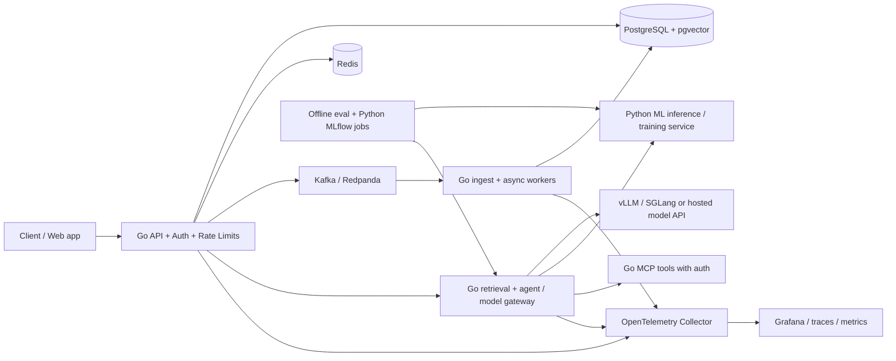

# Senior AI Systems Engineer — Go, Distributed Infrastructure & Production AI

**Specialization: Senior AI Systems / AI Platform Engineer | Rev. 27 October 2026 (Proxmox / $0 edition) | 7 months / 28 weeks | Go-first infrastructure, ML-runtime-aware systems design**

> This is a deliberately **Go-centered revision** of `senior-ai-ml-engineer-resources-and-exercises`. It integrates 
(1) the supplied **1st-semester mathematical foundations + classical ML syllabus**, 
(2) the source document's senior ML/LLM/MLOps depth, and 
(3) [AI Hero's learning map](https://www.aihero.dev/learn) and [engineering skills](https://www.aihero.dev/skills). This is an independent curriculum, not an official AI Hero course or a transcription of its paid content.
>
> **Career goal (confirmed):** design, implement, scale, secure, and operate **the platforms and applications around AI models**. Own inference gateways, data and retrieval paths, durable agent workflows, Kubernetes/cloud operations, cost, latency and reliability. Model training and research are supporting competencies—not the primary career track.
>
> **Career reality:** a seven-month roadmap develops evidence and interview readiness; the *senior* title also depends on demonstrated ownership and production experience.
>
> **Lab constraint (rev. 2026-10-27):** every exercise runs on the local Proxmox homelab — no VPS, no managed Kubernetes, no GPU rental. Paid steps from the source plan are converted to $0 equivalents (see [Homelab execution profile](#homelab-execution-profile--proxmox-0)). The one deliberate exception is a small public-cloud module on GCP Always Free, because Polish AI-platform postings treat hands-on cloud as close to a hard requirement.

## Changelog — Rev. 2026-10-27

- **Time split rebalanced: 40/25/25/10 → 30/25/25/20.** The 20% is no longer "Python literacy". It is an **ML runtime systems** track: PyTorch execution and GPU memory, CUDA/driver/wheel compatibility, Hugging Face artifacts, vLLM/SGLang engine internals, quantization, profiling and export. No syntax or FastAPI study; Python appears where it is the production norm (eval harness, benchmarks, model sidecars). A new column in the 28-week table carries this track week by week.
- **System design stays the spine:** every week opens with a written design/ADR; the time is counted inside the bucket it serves, not as a separate subject.
- **$0 infrastructure:** every VPS, managed cluster and GPU rental is converted to a Proxmox equivalent. `kind` is replaced by the existing 3-node k3s cluster (`kind`/`envtest` stay in CI). IaC = OpenTofu/Terraform with the `bpg/proxmox` provider. One cloud = a GCP Always Free module.
- **New section:** [Homelab execution profile](#homelab-execution-profile--proxmox-0) — hardware baseline, substitution table, RAM profiles per month, GPU strategy, local cost model, carry-over rule.
- **GPU strategy:** the RTX 4060 stays in its LXC as an external model endpoint; GPU scheduling is practised in k3s with run:ai `fake-gpu-operator` (+KWOK); VFIO passthrough is an optional, time-boxed weekend.
- **Observability defaults:** Arize Phoenix by default; Langfuse **v4** self-host only for a demo week (it needs ClickHouse); GlitchTip instead of Sentry; Zot instead of Harbor.
- **Inherited ML sections (§6, §8–13, §17) labelled with their tier.** Leftover "MUST-ADD" / "single biggest week" claims and an unverified "88% of EU postings" statistic removed.
- **§20 repaired:** the old Month-7 capstone, interview and positioning text is re-scoped to this track (headline no longer "Senior ML Engineer"); list numbering fixed.
- **§19 OSS targets** switched from Python agent frameworks to Go infrastructure projects (vLLM kept as the ML-runtime option).
- **Verification pass (27 Oct 2026):** Go 1.27, MCP 2026-07-28, MCP Go SDK v1.7+/v1.8.0, a2a-go v2.7.0, llm-d 1.0, Kubebuilder v4.16 + `envtest`, Langfuse OTLP — all confirmed. "Langfuse v3" → v4; Databricks Community Edition → Free Edition.
- **Market note added** from a small Oct 2026 sample of Polish postings (illustrative, not a measurement).

## Quick navigation

- [Changelog — rev. 2026-10-27](#changelog--rev-2026-10-27)
- [What changed and what remains](#what-changed-and-what-remains)
- [How the three sources fit together](#how-the-three-sources-fit-together)
- [Role boundaries and study priorities](#role-boundaries-and-study-priorities)
- [Homelab execution profile (Proxmox, $0)](#homelab-execution-profile--proxmox-0)
- [28-week execution plan](#28-week-execution-plan)
- [Go design-review rubric and release gates](#go-design-review-rubric-and-release-gates)
- [System architecture for the running capstone](#system-architecture-for-the-running-capstone)
- [§5: Go backend](#5-backend--go-services-apis-concurrency-and-security)
- [§7: Go distributed systems](#7-distributed-systems--messaging-in-go)
- [§21: Go system design interviews](#21-go-system-design--senior-engineering-skills)
- [§23–27: October 2026 AI + Go extensions](#23-multimodal-and-real-time-ai-systems)
- [References and verification notes](#references-and-verification-notes--25-oct-2026)

## What changed and what remains

**Primary engineering language: Go.** Write APIs, routing, streaming, ingestion, retrieval orchestration, feature services, model gateways, agent tools, rate limiting, caches, workers, metrics and production control planes in **Go**. Use `net/http` and standard library first, `pgx` for Postgres, `go-redis`, gRPC or Connect, OpenTelemetry, and Go's `testing`/race detector/benchmarks/`pprof`. Follow Go 1.27's release notes where applicable; pin versions and verify library support.

**Python/PyTorch as the ML runtime layer — system level, not syntax.** You already write Python; study time goes into *how the ML stack executes*, not the language: PyTorch's asynchronous CUDA execution and caching allocator, GPU memory accounting (weights + KV cache + activations + fragmentation), CUDA/driver/wheel compatibility, `torch.profiler`/Nsight traces, `torch.compile`/CUDA-graph tradeoffs, tokenizers and chat templates, Hugging Face cache layout and `safetensors`, the vLLM/SGLang scheduler and engine arguments, quantization formats (AWQ/GPTQ/GGUF/FP8), ONNX export with Triton/ONNX Runtime serving, and multi-LoRA adapter serving. Write Python where it is the production norm — eval harness, benchmark/load scripts, embedding/reranker sidecars, serving configs — and keep web frameworks as thin wrappers. Integrate with Go via HTTP/gRPC/OpenAI-compatible APIs. **Do not spend time on syntax drills, FastAPI tutorials or rebuilding training frameworks.**

**Suggested weekly allocation (a learning recommendation, not labor-market statistics):** **30% Go + distributed-system design**, **25% Kubernetes/cloud/IaC/SRE operations**, **25% AI serving, retrieval, agents, evaluation, security and cost**, **20% ML runtime systems (Python/PyTorch/vLLM at system level)**. At 15 hours/week, that is 4.5 / 3.75 / 3.75 / 3 hours. **System design is not a separate bucket:** every week opens with a written design/ADR (~1.5–2 h, counted inside the bucket it serves), and the §21/§27 drills run from Month 4. All four areas reappear in the same production system. Applied probability, metrics and model behavior are learned just in time for the AI systems being built.

**Why this split (market check, Oct 2026 — illustrative, small sample):** in ~18 Polish AI/ML-platform and MLOps postings reviewed, Python appeared in about 10 (often as the only language), Go in about 3 (always alongside Python), Kubernetes in most, a hands-on public cloud in nearly all, and Kubernetes operators in none. An EU-wide review of 65 remote MLOps postings reported Python 78.5% and Kubernetes 67.7%. Read this as: **Go is a differentiator; Python and one cloud are close to gates.** The Python gate is passed by Python *inside shipped systems* (eval harness, model sidecar, engine tuning, profiling evidence), not by more syntax hours. Keep C#/.NET on the CV as an asset — some Polish platform teams list it.

**Keep as required:** networks/Linux, databases, distributed correctness, Go services, cloud/Kubernetes, IaC, SRE, AI inference, retrieval, evals, auth, data privacy, and incident response. **Required in the ML runtime track:** transformers/KV cache, tokenization, GPU memory, quantization and serving-engine internals. **Keep to architectural literacy:** probability/calibration, classical ML, A/B tests, ranking and model drift. **Make elective unless a particular job demands them:** SVD/autograd from scratch, Kaggle leaderboard work, full classical ML algorithm implementations, end-to-end transformer training, RL/GRPO, distributed model training, multiple agent frameworks, multi-cloud breadth. The resource chapters below remain for reference; a historic “MUST” label in a source exercise does not override these priorities.

**New emphasis:** Go memory/concurrency; scalability and distributed correctness; Kubernetes controllers/operators (Kubebuilder, CRDs, reconciliation, RBAC — evidence of Kubernetes depth; operators were not an explicit requirement in sampled postings); autoscaling, GPU-aware workload placement and queue management; Terraform and one public cloud; SLIs/SLOs and failure drills; model gateway and cache economics; multi-tenancy and privacy; trace-linked evals, resilient MCP tools and human approval; cost per successful AI task. Evaluate A2A and disaggregated serving conceptually before investing in complex implementations.

### Deliverable contract (every Core/Stretch)

1. **Design first:** `DESIGN.md` (requirements/non-goals, estimated QPS/storage/cost, APIs/schemas, diagram, scaling bottleneck, 3+ tradeoffs); `ADR-*.md` for choices that could reasonably differ.
2. **Build in Go:** tests (`go test ./...`, race detector where meaningful), production-style logging/trace propagation, graceful shutdown, bounded queues/timeouts, error handling, and API contract tests. Training/notebooks may use Python.
3. **Test failure:** one recovery experiment—kill a worker, delay the model provider, drop broker messages, break a migration, exhaust connections, or inject malformed tool output.
4. **Measure:** reproducible `BENCHMARKS.md` with p50/p95/p99 latency, throughput, CPU/RAM (and GPU memory for model-serving work), cost (local: energy + amortisation; hosted: dated list price), error rate, machine configuration, and for AI systems quality/retrieval/task-completion metrics. Never invent a benchmark result or assume an arbitrary performance threshold is achievable.
5. **Ship safely:** an eval set and release gate appropriate to the system; for AI features start with **20+ curated regression cases** and grow to **100+ representative cases** before the final capstone. Human-review unsafe side effects. Add `RUNBOOK.md`, `THREAT_MODEL.md`, and `MODEL_CARD.md` where relevant.

## How the three sources fit together

| Source | What remains useful | How this specialized track uses it |
| --- | --- | --- |
| **Attached semester-1 math + ML syllabus image** | Vectors/distances, probability, metrics, algorithms, regression/classification, trees, ensembles, clustering, optimization | **Literacy track:** understand why a model fails, which metric is appropriate, how embeddings/ranking work, and where data leakage appears. Hand implementations are optional exercises rather than weekly requirements. |
| **Original 7-month resources/exercises Markdown** | Production ML, cloud/MLOps, RAG, agents, serving, evals, tests and extensive repositories | **Reference library:** concentrate on §§1–7, 14–16, 18–19 and 21–27; §12–14b feed the ML runtime track. Use §8–11 and §17 to close gaps relevant to deployments, not as independent full-depth tracks. |
| **[AI Hero /learn](https://www.aihero.dev/learn)** | Requirements-first engineering, specs, small tickets, test-first implementation, review, context hygiene | **AI-assisted implementation discipline:** ask AI to write code, but personally own acceptance tests, concurrency behavior, security reviews, incident diagnosis, architecture and outcomes. |

## Role boundaries and study priorities

**You are learning to build the system *around* the model:**

```text
Client → Go API (auth, quotas, rate limits, streaming)
       → Go retrieval / workflow / model gateway
       → [Postgres + pgvector] [Redis] [queue/broker]
       → [Python model or vLLM/SGLang/managed model endpoints]
       → OpenTelemetry → SLOs + dashboards + incident response
       → Kubernetes + one cloud + Terraform/GitOps + deployment policies
```

### Must be able to do without trusting generated code blindly

- Review Go concurrency (`context`, locks, cancellation, goroutine leaks, bounded queues), backpressure, database consistency and schema changes.
- Diagnose p95/p99, TTFT, inter-token latency, output-token throughput, queue depth, cache hit ratios, GPU memory and request cost; explain whether the bottleneck is CPU, I/O, network, scheduler, or model serving.
- Design APIs/data contracts and failure semantics: timeouts, retries with budgets, idempotent replays, circuit breakers, failover, overload shedding, tenant quotas.
- Deploy services on Kubernetes, distinguish workload controllers from inference servers, read events/logs/traces, implement readiness/liveness, resource limits, HPA/KEDA, rollouts and rollback.
- Integrate model endpoints, embedding/retrieval layers and tools; evaluate quality, citations, hallucination risks, prompt/tool injection and policy-breaking side effects.
- Run and debug the ML runtime at system level: CUDA/driver/PyTorch wheel compatibility, GPU memory accounting (weights + KV cache + activations + allocator fragmentation), `torch.profiler`/Nsight traces, vLLM/SGLang engine arguments and `/metrics`, tokenizer/chat-template mismatches, quantized checkpoint formats — and **own the integration boundary between Go and Python**.

### Priority tiers for the rest of this reference document

| Tier | Required evidence | Topics |
| --- | --- | --- |
| **P0 — Career core** | Design doc, working Go service, K8s deploy, tests, traces, load/fault benchmark, runbook | Go backend, network/databases, caching, queueing/outbox, consistency, IaC (OpenTofu/Terraform on Proxmox), one cloud (GCP free tier), K8s (k3s), operators/CRDs, SRE/security |
| **P1 — AI platform core** | Working model gateway + retrieval service with gold evals, latency/cost metrics, tracing and rollback | Inference serving (vLLM/SGLang), RAG/search, embeddings, evals, agents/MCP, tool security, model routing, cost controls, **ML runtime systems** (PyTorch execution/GPU memory, HF artifacts, engine internals, quantization, profiling, export) |
| **P2 — Working literacy** | Explain, reproduce and debug a baseline | Supervised ML, metrics/leakage, calibration, model drift, ranking/A-B basics, Python ML ecosystem breadth beyond the runtime track |
| **P3 — Optional depth** | Only if a role or personal research demands it | Autograd from scratch, Kaggle competitions, deep architecture of training kernels, multi-GPU fine-tuning, GRPO, exotic agent frameworks, frontier multimodal research |

**One-cloud rule ($0 version):** Kubernetes, IaC and operations live on Proxmox. Cloud evidence comes from one scripted module on **GCP Always Free** using the billing account you already have: Terraform-managed IAM + Workload Identity Federation from GitHub Actions, Artifact Registry (0.5 GB free), Secret Manager (6 active versions free), Cloud Run (2M requests/month free), Cloud Monitoring and billing budget alerts. GKE's free tier covers the cluster fee only, never nodes — run it only in short scripted `apply`/`destroy` sessions, or skip it. Polish "AI Platform" ads skew Azure (AKS, AI Foundry, APIM) and AWS; if those are your targets, add an optional Azure mini-project inside the 30-day $200 credit window in Month 7. A homelab-only portfolio reads as "no production cloud" — the cloud module is cheap, not optional. Read comparative docs for the others; do not claim hands-on expertise across three clouds after tutorials.

## Homelab execution profile — Proxmox, $0

**Baseline (record actual values in a `LAB.md` and update it as hardware changes):** Proxmox VE 9.2, single node · ~29 GiB usable RAM · 337 GB LVM-thin pool · Intel i7 · RTX 4060 8 GB (Ada) bound to LXC containers via `/dev/nvidia*` bind-mount · 3-node k3s cluster in VMs 201–203 · Tailscale on the host for admin access. Setup reference: project doc `pesonal Proxmox.md`.

**Ground rules**

1. **No paid servers.** No VPS, managed Kubernetes or GPU rental anywhere in the required path. Anything that can still cost money is marked *optional* with a cap.
2. **Proxmox is "production".** Treat VMs/LXCs as cattle: cloud-init template → clones via OpenTofu/Terraform (`bpg/proxmox` provider, which targets PVE 9.x; it is 0.x, so pin the version) → configuration. A full rebuild from `tofu apply` is itself a deliverable.
3. **Snapshot before risk** (driver/kernel updates, VFIO, cluster upgrades). Pin the kernel when the NVIDIA DKMS module lags (`proxmox-boot-tool kernel pin`). After every host kernel update, verify `nvidia-smi` on the host first, then inside the LXC.
4. **Disk:** keep the thin pool under 75–80% `Data%` (`lvs`). Models, images and datasets compete for the same 337 GB.
5. **Public exposure only through** Cloudflare Tunnel or Tailscale Funnel, with auth and per-IP rate limits in the Go gateway first. Never expose 8006/SSH.

**Paid item → $0 substitute**

| Source-plan item | $0 replacement on this lab | Caveat |
| --- | --- | --- |
| €5 Hetzner VPS ×3 (§1) | Cloud-init Ubuntu 24.04 template → 3 clones (OpenTofu `bpg/proxmox` or `qm clone`) | Pin the provider version |
| DigitalOcean managed cluster (§3) | Existing 3-node k3s cluster | No managed control plane — that is the learning |
| `kind` as the main cluster (Week 9) | k3s for staging/"prod"; `kind` only in GitHub Actions; Kubebuilder `envtest` for controller tests | `envtest` has no kubelet — pods never run |
| Multipass (§3 Stretch) | Proxmox VMs from the same template | — |
| Public-cloud deep track (Week 11, MLOps section) | GCP Always Free module in Terraform (see one-cloud rule) | Overage bills at list price — budget alert + scripted `destroy` |
| RunPod / rented 24 GB GPU (§14, §14b, Capstone 5) | Local RTX 4060 (3–4B INT4 comfortable; 7–9B 4-bit at ~4K context, low concurrency) + an analytical 24 GB projection labelled as an estimate | Relative comparisons only; no absolute throughput claims |
| Multi-GPU FSDP (§14) | Concepts + memory math (P3) | — |
| Hosted model endpoints under load (Weeks 17–19) | **Load:** local vLLM/llama.cpp + a Go mock OpenAI-compatible provider with injected latency/errors. **Correctness/fallback:** free tiers (e.g. OpenRouter `:free` ≈ 20 RPM / 50 requests per day; Groq free plan) or pay-per-call accounts you already use | Free tiers are useless for load tests; never send private data to tiers that use inputs for training |
| Cohere Rerank (§15) | `bge-reranker` on GPU or CPU | — |
| Langfuse Cloud / LangSmith (§16) | Arize Phoenix (single container, OTLP) by default; Langfuse v4 self-host for one demo week | Langfuse needs ClickHouse; its Compose guidance is ~4 cores / 16 GiB |
| Arize/Fiddler trial (§19) | Phoenix self-hosted + Evidently | — |
| Sentry (§4) | GlitchTip (Sentry-SDK-compatible) | — |
| Harbor | Zot (single-binary OCI registry) or GHCR for public images | — |
| Databricks Community Edition (§6) | Databricks Free Edition (Community Edition retired 1 Jan 2026) — elective | Not for commercial use |
| Portfolio site on a VPS (§20) | GitHub Pages / Cloudflare Pages | — |
| interviewing.io (§20) | Peer mocks; paid mocks optional | — |

**RAM profiles (rough estimates — measure with the Proxmox summary and `free -h`, then correct this table).** ~29 GiB cannot run k3s + data plane + observability + GPU serving + Langfuse at once. Script start/stop profiles (`qm start|stop`, `pct start|stop`) per month:

| Months | Running | Approx. RAM |
| --- | --- | --- |
| M1–M2 (Weeks 1–8) | One "dev" VM with Compose: Go services, Postgres, Redis, Redpanda (`--smp 1 --memory 1G`), lean LGTM stack; k3s VMs stopped | 8–10 GiB |
| M3 (Weeks 9–12) | k3s 3 nodes + Argo CD + Zot + operator development; GPU LXC stopped | 12–16 GiB |
| M4 (Weeks 13–16) | k3s + pgvector/Qdrant + embedding/reranker (GPU LXC or CPU) + Phoenix | 16–22 GiB |
| M5 (Weeks 17–20) | GPU LXC (vLLM/SGLang; host RAM is needed for model loading) + gateway on k3s (scale to 2 nodes) + `fake-gpu-operator` | 18–24 GiB |
| M6–M7 (Weeks 21–28) | Integrated platform, desktop LXC off; Langfuse only in its demo week | 22–28 GiB |

**GPU strategy (one RTX 4060)**

- **Default A — external endpoint:** the GPU stays in its LXC; vLLM/SGLang/llama.cpp is exposed to k3s via a selector-less Service + EndpointSlice (or ExternalName). This is the realistic "platform consumes a model endpoint" architecture and causes no driver churn.
- **Default B — simulated GPUs in k3s:** run:ai `fake-gpu-operator` advertises `nvidia.com/gpu` on labelled nodes (with fake utilisation for KEDA/HPA); KWOK adds 100-node fleets for almost no RAM. Practise requests/limits, labels/taints, node pools, quotas and your `InferenceDeployment` operator. READMEs must state that pods do not get a real GPU.
- **Optional C — one VFIO weekend:** pass the 4060 to a k3s GPU worker VM (q35 + OVMF, GPU + audio functions, `vfio-pci`), run the NVIDIA device plugin with time-slicing, then switch back. The GPU is exclusive while bound, so LXC GPU workloads stop; snapshot first and script the switch. Write it up — it is the strongest interview story of the three.
- **Gate before Week 17:** `nvidia-smi` works on the host *and* inside the LXC with an identical driver version; record driver, kernel, CUDA and PyTorch versions in `LAB.md`. Nothing before Week 17 requires the GPU (ML-runtime items before then fall back to CPU or predictions).

**Local cost model (for "cost per successful task"):** local cost = measured watts × hours × your electricity tariff + hardware amortisation; hosted cost = provider list price at a dated snapshot. Report both; never call local inference "free".

**Carry-over rule (switching mid-way from the July plan):** do not restart from zero. If you are already in the Kubernetes block with a working k3s cluster, finish it now as **Week 0** (it counts toward Weeks 9–10), then run Weeks 1–8 in Go and treat Weeks 9–10 as review plus Helm/GitOps. Compress any week whose foundations (Linux, Postgres, Docker, OTel) you have already shipped — the Go implementation is what is new.

## 28-week execution plan

**Weekly cadence:** one written architecture decision/design → one Go implementation → one deployment/operational or AI quality experiment → one ML-runtime measurement (~3 h) → one recorded benchmark/postmortem. AI coding assistance is permitted, but a human must be able to explain all production-critical code and observed behavior. Aim for one evolving portfolio system rather than disconnected tutorials.

| Week | Go, systems and cloud engineering (main track) | AI platform integration / reliability | ML runtime systems (Python/PyTorch, ~3 h) | Evidence |
| --- | --- | --- | --- | --- |
| **M1 · 1** | Go stdlib, module boundaries, HTTP, `context`, error handling, table tests | API and basic numerical/data contracts | ML environment as a system: `uv` lockfile, CUDA/driver/PyTorch wheel matrix, CPU-only baseline container | Go API with tests and documented design; `LAB.md` version matrix |
| **2** | Concurrency, mutex/channels, bounded pools, cancellation, race detection | Cost of parallel model calls; concurrency limits | PyTorch execution model: async CUDA kernels, `synchronize`, why naive timing lies; GIL vs processes; `torch.utils.benchmark` | Worker benchmark and leak/race regression tests |
| **3** | PostgreSQL/pgx, EXPLAIN/indexes, Redis caching, keyset pagination | Retrieval and embedding metadata schemas | Embedding throughput vs batch size and sequence length; vector dtype/storage cost (`vector` vs `halfvec`) | Query benchmarks plus migrations |
| **4** | Docker, CI/CD, OTel, profiling, reverse proxy, TLS, SLOs | Stubbed model backend with timeouts | Model sidecar container: CPU vs CUDA image size, model load and warm-up time, readiness gating | **Capstone 1:** Go API gateway on a Proxmox VM + incident report |
| **M2 · 5** | gRPC/Connect vs HTTP, API versioning, idempotency, retry budgets | Streaming token proxy (SSE), client cancellation | Tokenizers and chat templates: Go/Python token-count parity, streaming detokenization, template-mismatch failures | Model-proxy contract tests |
| **6** | Kafka/Redpanda, transactional outbox, dedup, replay | Asynchronous inference/request jobs | Python batch-inference consumer: batch sizing, OOM back-off to smaller batches, idempotent outputs | Crash-recovery assertions + traces |
| **7** | Partitioning, overload, backpressure, consistency, sagas where applicable | Batching, queue fairness and tenant quotas | GPU memory math: weights + KV cache + activations by dtype; predict now, verify with `torch.cuda.memory_summary` once the GPU gate passes | Capacity model and failure matrix |
| **8** | Deploy broker/workers safely; data correctness drills | Distributed event-driven ingestion | `torch.profiler` + Chrome trace on an embedding job: tokenization (CPU) vs compute vs data loading | **Capstone 2:** durable Go job platform + replay runbook |
| **M3 · 9** | Kubernetes Pods/Deployments/Services/Ingress/ConfigMaps/Secrets on your **k3s** cluster (`kind` in CI) | Containerized model endpoint interface | Model artifacts: `safetensors` vs pickle risk, HF cache layout, model download via init container/PVC, revision pinning | Deployment manifests, probes, smoke tests |
| **10** | Helm, GitOps (Argo CD or Flux) on k3s, Zot/GHCR registry, safe rollouts, rollback | Model/config version routing, canary evaluation | Model registry (self-hosted MLflow or HF revision pins); ONNX export of a small classifier/reranker + numerical parity test | Rollout/rollback demo |
| **11** | OpenTofu/Terraform: `bpg/proxmox` VMs + cloud-init → k3s; GCP Always Free module (IAM/WIF, Artifact Registry, Secret Manager, Cloud Run, monitoring, budgets) | Cost tags, token accounting and provider budgets | ONNX Runtime CPU serving for the Cloud Run deployment: latency vs PyTorch eager | Lab rebuilt from `tofu apply`; GCP budget alert + destroy log |
| **12** | Kubebuilder and Go controllers: CRDs, reconcile loop, finalizers, RBAC; `envtest` + e2e on k3s | Reconcile an `InferenceDeployment` against simulated GPU node pools (`fake-gpu-operator`) | Map vLLM engine arguments (model, revision, quantization, `max-model-len`, `gpu-memory-utilization`) into the CRD spec + validation | **Capstone 3:** Kubernetes operator on k3s + Cloud Run deployment |
| **M4 · 13** | Search service architecture, ingestion pipelines, access control | Embeddings, BM25/dense/hybrid retrieval | Embedding model choice as a systems decision: dimensions, latency, GPU vs CPU, batch, re-embedding cost | Retrieval baseline + recall@k |
| **14** | Index versioning/rebuild, event processing, ACL filters | Rerankers, citations, dataset/eval quality | Cross-encoder reranker cost: batch, truncation length, p95 on GPU vs CPU; sizing a re-embedding job for model upgrades | End-to-end trace from query to answer |
| **15** | Multi-tenancy, authn/authz, prompt injection and data exfiltration defenses | 100-case retrieval/answer eval, adversarial cases | Python eval harness as a system: versioned datasets, seeds, judge calibration (Cohen's κ / QWK), CI runtime budget | Tenant-isolation and red-team tests |
| **16** | Adaptive cache, rate limits, quotas and provider fallback | Structured output, model quality-cost comparison | Constrained decoding (xgrammar / vLLM guided decoding): schema-validity rate vs latency cost | **Capstone 4:** production Go RAG gateway + eval gate |
| **M5 · 17** | Go inference reverse proxy and admission control | Local vLLM/SGLang (GPU LXC) + Go mock provider for load; hosted free tiers for correctness only; token budgets | vLLM engine internals: scheduler, PagedAttention, continuous batching, `/metrics` (waiting requests, KV-cache usage); engine-argument tuning on 8 GB | TTFT/TPOT/p95/load results |
| **18** | Queueing, batching, autoscaling, GPU scheduling fundamentals | KV/prefix caching, quantization and context tradeoffs | Quantization on Ada: AWQ vs GPTQ vs GGUF vs FP8 — memory, speed and quality on your own eval set; KV-cache dtype | Cost-per-successful-answer dashboard (local energy + amortisation vs hosted list price) |
| **19** | KEDA/HPA, GPU scheduling with `fake-gpu-operator` node pools (labels/taints/quotas); optional VFIO weekend with device plugin + time-slicing; optional KServe | Compare local vs hosted model on quality, local vs mock fleet under load | Multi-LoRA adapter serving in vLLM (hot-load, per-tenant adapters) vs SGLang | Architecture and capacity ADR |
| **20** | Load shedding, failure isolation, performance profiling and rollback | Structured-output/streaming resilience | Runtime failure drills: CUDA OOM, driver/kernel mismatch after a host update, model-load timeout, `torch.compile`/CUDA-graph warm-up vs `--enforce-eager` | **Capstone 5:** scalable inference gateway + failure drills |
| **M6 · 21** | Go state machines, job persistence, compensation and human checkpoints | Deterministic workflow vs agent; tool-eval metrics | Small local models for tool calling: function-call formats, parser failures, guard/classifier sidecar latency | Crash-resumable job and tests |
| **22** | Go MCP server/client (official Go SDK v1.7+, 2026-07-28 spec, stateless streamable HTTP), OAuth or service identity, per-tool authorization | Tool schema validation, prompt/tool-injection defenses | Python-backed tools behind MCP: timeouts, payload caps, returning references (paths/IDs) instead of large payloads | Hardened read-only tool service |
| **23** | Durable tasks, event audit, retries, outbox, timeouts | Context compaction, memory boundaries and evals | Tokenizer-accurate context budgets; prefix stability vs KV-cache reuse measured on local vLLM | Long-horizon task benchmark |
| **24** | Go operator/controller integration with safe agent workflows | Model/tool/provider failure handling, optional A2A comparison | QLoRA fine-tune (Unsloth/PEFT) of a small model on the 4060 as a *pipeline*: data version → train → eval gate → adapter served via the operator | **Capstone 6:** audited AI workflow platform |
| **M7 · 25** | Senior system-design drills: AI support, search, rate-limited inference | Estimating retrieval/model performance and unit cost | ML system-design drills: training pipeline, feature store, serving fleet — draw the Go/Python boundary each time | Three timed design docs |
| **26** | SRE: chaos, capacity, bottleneck diagnosis, error budgets | Quality degradation and regression alerts | GPU observability: DCGM/`nvidia-smi` exporters, Xid errors, thermal throttling; runbook entries | Runbooks + dashboards + postmortem |
| **27** | K8s RBAC and network policies, GCP IAM/WIF review, secret rotations, threat model | Model and dataset boundaries; data retention/deletion | Model supply chain: `safetensors`, hashes, licences, model/dataset cards | Security evidence and review |
| **28** | Operational hardening, reliability architecture defense | End-to-end AI quality, cost and tracing review | ML-runtime review: memory budget, engine settings and quantization choices defended with your own measurements | **Capstone 7:** integrated platform, public demo (Cloudflare Tunnel/Tailscale Funnel + recorded video) and 10-min design defense |

### Seven portfolio capstones (one evolving architecture)

1. **Go AI API gateway:** request admission, auth, quotas, SSE streams, cancellation, Redis, OTel and load tests; mock model so no GPU is required; deployed to a Proxmox VM.
2. **Durable job and event platform:** Go workers, Postgres transactional outbox, Kafka/Redpanda consumers, dedup, replay and chaos tests.
3. **Kubernetes inference operator:** Kubebuilder CRD/controller, retries/reconciliation/status conditions, RBAC and rollback; tested with `envtest` and on k3s against simulated GPU pools (`fake-gpu-operator`); the gateway image is also deployed to Cloud Run via Terraform. Prove operator behavior under failure, not just creation of CRD YAML.
4. **Secure retrieval platform:** Go RAG orchestration + pgvector/Qdrant + hybrid retrieval, tenant-level authorization, citeable answers, 100-case evals and cost dashboards.
5. **Inference routing platform:** Go gateway routing hosted + self-hosted models, token-aware admission, latency/TTFT/TPOT/load, fallback and quota cost accounting; local RTX 4060 for self-hosted serving, a Go mock provider for load, free or pay-per-call hosted APIs for correctness — no GPU rental.
6. **Durable agent workflow system:** Go job/state machine and official MCP SDK integration, structured tool contracts, human approval for side effects, recovery and trace-linked evaluation.
7. **Integrated AI systems platform:** k3s on Proxmox plus the GCP free-tier module, operator, gateway, retrieval, model service, observability, security and incident rehearsals—with an architecture document explaining tradeoffs at 10× and 100× scale.

**Capstone domain (recommended):** run all seven milestones on one real workload instead of a toy. A strong fit is your IELTS essay-scoring work: moderator band scores are a ready-made gold set (MAE, exact/±0.5-band agreement, quadratic weighted kappa), there are real users, and "tuned hosted model vs local open model" is a genuine routing, cost and quality decision for the gateway. Keep raw essays and any personal data out of public repos — publish synthetic or public samples and aggregate metrics only.

**Non-goals for this specialization:** training a foundation model, mastering every Kaggle algorithm, rebuilding PyTorch in Go, inventing a novel transformer, or collecting framework badges. Take elective depth only when an actual platform problem requires it.

## Go design-review rubric and release gates

Score each dimension from 0 (missing) to 2 (clear evidence). **Target ≥22/26** by the end; the point is to expose missing engineering evidence, not to award credentials.

| Dimension | What a convincing artifact shows |
| --- | --- |
| Requirements & non-goals | Users, boundaries, freshness/latency targets, human actions |
| Capacity & cost | QPS, tokens/sec, vector/doc volumes, peak shape, unit economics |
| Data model | Key choices, indexes, schema migration, retention/deletion |
| Contracts | REST/gRPC/Connect and versioning, explicit errors, idempotency |
| Concurrency | Goroutine ownership, `context` cancellation, bounded queues |
| Consistency | Transaction boundary, outbox, deduplication, replay |
| Reliability | Timeouts, retries with jitter, backpressure, overload/failover |
| Security | Authn/authz, tenant isolation, secrets, tool trust, prompt injection |
| Observability | RED + OTel traces, user privacy, dashboards, alert runbook |
| Performance | p95/p99, CPU/RAM, `pprof`, reproducible load benchmark |
| ML runtime | GPU memory budget, engine arguments, quantization choice and profiler evidence that explain the observed latency |
| AI correctness | Baselines, offline/online metrics, eval coverage, judge validation |
| Operations | CI, rollout and rollback, ownership, incident postmortem |

**Required gates:** `go fmt`/`go vet`/tests, race tests, API contract/integration tests, secret/dependency scans, smoke tests, 20+ eval cases on each AI-changing PR, failure drill before monthly release, documented rollback. Use `golangci-lint` if it improves signal; avoid adding slow or noisy lint rules merely for a badge.

### The engineering loop inspired by AI Hero (works with or without agents)

1. **Clarify + challenge requirements:** `QUESTIONNAIRE.md`, examples, edge cases; reject vague scope.
2. **Write a spec** with interfaces, constraints, acceptance tests, data flows and a short decision log.
3. **Split into thin tracer-bullet tickets:** one end-to-end observable behavior per task (HTTP → DB → metric → test), not horizontal framework building.
4. **Implement test-first:** agent assistance is optional; run Go table tests, integration tests and race detector; maintain `AGENTS.md` with instructions scoped to the repo.
5. **Review two questions separately:** *is it the right feature?* and *is it implemented to engineering standards?* Inspect any security-sensitive tool/agent actions manually.
6. **Retro:** record missing context, flaky tests, repeated failure patterns; improve the repo and evaluation corpus rather than just the next prompt.

AI Hero references: [Learn map](https://www.aihero.dev/learn), [LLM Fundamentals](https://www.aihero.dev/llm-fundamentals), [AI Engineer Roadmap](https://www.aihero.dev/ai-engineer-roadmap), [Skills](https://www.aihero.dev/skills), [Tracer bullets](https://www.aihero.dev/learn).

## System architecture for the running capstone



**Deployment principle:** one Compose environment on a Proxmox VM first; move to the k3s cluster only after APIs, tests and contracts work (`kind`/`envtest` stay in CI). Separate control plane (Go routing, auth, observability, queues — on k3s) from model training/serving plane (Python/PyTorch/vLLM/SGLang — in the GPU LXC, reached as an external endpoint). Never pretend local GPU inference is free: price it with the local cost model.

---

## 1. Foundations — Linux, Networking, Shell, Git

Non-negotiable substrate. Fluency here multiplies every later topic.

**GitHub**

- **jlevy/the-art-of-command-line** (~155k★) — https://github.com/jlevy/the-art-of-command-line — condensed CLI checklist.
- **trimstray/the-book-of-secret-knowledge** (~180k★) — https://github.com/trimstray/the-book-of-secret-knowledge — sysadmin/networking cheatsheets, active.
- **denysdovhan/bash-handbook** (~7k★) — https://github.com/denysdovhan/bash-handbook — bash 80/20.
- **kamranahmedse/developer-roadmap** — https://github.com/kamranahmedse/developer-roadmap — gap-finder, not a curriculum.
- **donnemartin/system-design-primer** (~348k★) — https://github.com/donnemartin/system-design-primer — networking/CDN refreshers.
  **Kaggle** — Skip for this topic. Use **Linux Journey** (https://linuxjourney.com) and **TLDR pages** (https://tldr.sh) instead.

**One must-read** — Julia Evans’ zines (https://wizardzines.com).

### Exercises

**Warm-up (1-2 hr)** — Clone `trimstray/the-book-of-secret-knowledge`. Pick 10 CLI tools or networking commands you’ve never used (`tcpdump`, `ss`, `ip route`, `nft`, `iotop`, `mtr`, `dig +trace`, etc.). For each, write one paragraph in your own words explaining what it does and _when you’d reach for it_. Push as `cli-notes.md` to a personal `engineering-notes` repo.

**Core (1-2 days)** — Build a cloud-init Ubuntu 24.04 template on Proxmox and clone three VMs (OpenTofu `bpg/proxmox` or `qm clone`). Write a ~200-line bash hardening script: non-root user, SSH keys only, ufw, fail2ban, unattended-upgrades, Docker, Caddy. Run it on the three fresh clones from cold-boot to ready-state in <5 minutes each. Commit to a public `lab-playbook` repo with a README that includes a tcpdump-annotated TLS 1.3 handshake screenshot (Caddy with its internal CA on a lab VM).

**Stretch (multi-day)** — Extend the Proxmox homelab you already run: Caddy reverse proxy, Tailscale ACLs (Tailscale already runs on the host — no ZeroTier needed), Renovate or Watchtower-style updates, Uptime Kuma monitoring, a Gitea/Forgejo mirror of your repos, and one self-hosted service you actually use (Vaultwarden, Miniflux, or similar). Document everything as a “Day 1 onboarding guide” as if a teammate had to recreate it from scratch. Bonus: publish as a blog post.

- [ ] Clone 3 VMs from a cloud-init template on Proxmox. Write a 200-line bash hardening script: non-root user, SSH key only, ufw, fail2ban, unattended-upgrades, Docker installed. Run it on all 3 clones.
- [ ] Write a systemd unit for a Go API service with restart policy, journal logging, healthcheck, and resource limits. Verify it survives `reboot`.
- [ ] Capture a TLS 1.3 handshake to a lab VM with `tcpdump`. Annotate every packet by hand in a markdown file.
- [ ] Identify 3 listening services with `ss -tlnp` + `lsof -i`. Explain what each does in your notes.
- [ ] Use `strace` to find which config file a Python script reads. Use `dig` to fetch all 6 record types for a domain.
      **Ship:** Public `lab-playbook` repo with hardening script + a one-page playbook you'll reuse all year.

**Resources:** Julia Evans' networking zines · `man bash` · the Linux Performance tools tour by Brendan Gregg.

---

## 2. Databases & SQL — Postgres, Redis, Analytical SQL

A senior should read EXPLAIN plans like prose. Postgres + Redis + DuckDB is the modern default.

**GitHub**

- **dhamaniasad/awesome-postgres** — https://github.com/dhamaniasad/awesome-postgres — extensions, GUIs, replication.
- **postgres/postgres** — https://github.com/postgres/postgres — `src/backend/optimizer/README` is required reading once.
- **duckdb/duckdb** — https://github.com/duckdb/duckdb — modern columnar query execution.
- **redis/redis** — https://github.com/redis/redis — `src/t_*.c` files (one per data type) are a master class.
  **Kaggle**
- **Intro to SQL** — https://www.kaggle.com/learn/intro-to-sql.
- **Advanced SQL** — https://www.kaggle.com/learn/advanced-sql — best for window-function fluency.
  **One must-read** — Markus Winand’s **Use The Index, Luke!** (https://use-the-index-luke.com).

### Exercises

**Warm-up (1-2 hr)** — Complete the Kaggle **Advanced SQL** course end to end. Every exercise, every hidden cell. Push the notebook to a `sql-portfolio` repo with brief commentary at each step on _why_ the technique works (not just that it does).

**Core (1-2 days)** — Download a Stack Exchange data dump (or the Stack Overflow Public Dataset on BigQuery). Write 20 progressively harder queries: simple joins → window functions → CTEs → recursive queries → gaps-and-islands. Run `EXPLAIN ANALYZE` on each in Postgres. Include the pagination challenge: page 10,000 of a 10M-row table in under 50ms using keyset pagination. Document trade-offs in a `BENCHMARKS.md`.

**Stretch (multi-day)** — Clone `postgres/postgres`, read `src/backend/optimizer/README`. Then on your 10M-row table, _deliberately_ force three different query plans (seq-scan vs index-scan vs bitmap heap scan) using `set enable_seqscan = off` and similar knobs. For each, measure actual runtime, predict the planner’s choice with cost numbers, and explain in writing why the planner chose what it chose. Bonus: contribute a documentation fix or a typo PR to `postgres/postgres` (their `doc/` directory is great for first-time contributors).

- [ ] Load one mid-sized Stack Exchange site dump into Postgres (a few GB — the full ~50 GB Stack Overflow dump competes with models for the 337 GB thin pool), or generate 10M rows with `generate_series`. Write 20 queries progressing join-heavy → window-function-heavy. EXPLAIN ANALYZE each.
- [ ] Pagination challenge: 10M rows, page 10,000, under 50 ms. Solve with keyset pagination; write up why OFFSET fails.
- [ ] Force a deadlock between two transactions on purpose. Resolve it. Document the chain from `pg_locks`.
- [ ] Migrate a column type on a 10M-row table with zero downtime: dual-write → backfill → rename. Time each step.
- [ ] Implement a Redis distributed lock. Read the Redlock debate. Add probabilistic early expiration to defeat cache stampedes.
- [ ] Write 10 analytical-SQL queries: rolling averages, dense_rank, gaps-and-islands, sessionisation, cumulative distribution, top-N-per-group.

---

## 3. Containers, Kubernetes, CI/CD

You don’t need to be a K8s wizard, but you must debug a `CrashLoopBackOff` at 2am.

**GitHub**

- **kelseyhightower/kubernetes-the-hard-way** (~42k★) — https://github.com/kelseyhightower/kubernetes-the-hard-way — manual cluster provisioning.
- **docker/awesome-compose** — https://github.com/docker/awesome-compose — production-shaped compose stacks.
- **kubernetes/examples** — https://github.com/kubernetes/examples — official YAML examples.
- **actions/starter-workflows** — https://github.com/actions/starter-workflows — reference GitHub Actions.
  **Kaggle** — No good content. Use **KodeKloud free labs** + **CNCF YouTube**.

**One must-read** — Nigel Poulton, _The Kubernetes Book_ (paid, ~$15).

### Exercises

**Warm-up (1-2 hr)** — Hand-write Dockerfiles (no AI assist) for a **Go API**, a Python model-serving sidecar, and a small Go worker. Use multi-stage builds + BuildKit cache mounts. Keep the Go images static/distroless; shrink the Python sidecar as far as is honest (CPU wheels vs CUDA runtime base) and record size and cold-start time. Push to GHCR (or a Zot registry on the lab). Document the size-reduction steps as `DOCKER_OPTIMIZATION.md`.

**Core (1-2 days)** — Pick any 3-service stack from `docker/awesome-compose` (e.g., Nginx + Flask + Postgres). Convert it to raw Kubernetes YAML: Deployments, Services, ConfigMaps, Secrets, Ingress, liveness/readiness probes, resource requests/limits. Deploy to `kind` first, then to your 3-node k3s cluster on Proxmox. No Helm yet. Push the manifests + a README explaining each resource.

**Stretch (multi-day)** — Walk through `kelseyhightower/kubernetes-the-hard-way` on Proxmox VMs cloned from your template (free, identical learning). Spin up control plane and workers by hand. When it works, deliberately kill the controller-manager pod and observe what happens. Document each step with screenshots. Then write a GitHub Actions pipeline that lints → tests → builds → Trivy-scans → pushes to GHCR → deploys via SSH or Argo CD. Break it three different ways on purpose and fix each in under 10 minutes.

- [ ] Hand-write Dockerfiles (no AI assist) for Go API, Go worker, Python model service. Use multi-stage builds + BuildKit cache mounts. Record image size and cold-start time for each; justify the Python sidecar's base image.
- [ ] docker-compose stack: Postgres + Redis + API + nginx + Grafana + Prometheus, with healthchecks, `depends_on` conditions and memory limits.
- [ ] On your k3s cluster (and `kind` in CI), deploy a 3-service app — pods, deployments, services, ingress, configmaps, secrets, probes. Raw YAML, no Helm yet.
- [ ] GitHub Actions pipeline: lint → test → build → Trivy scan → push to GHCR → deploy via SSH. Add a matrix build and a reusable workflow.
- [ ] Break your own pipeline three ways (bad cache, missing secret, failing test). Fix each in under 10 minutes.

---

## 4. Observability & SRE

If you can’t see your system, you don’t own it.

**GitHub**

- **open-telemetry/opentelemetry-python** — https://github.com/open-telemetry/opentelemetry-python.
- **grafana/grafana** + **grafana/loki** + **grafana/tempo** — https://github.com/grafana.
- **prometheus/prometheus** — https://github.com/prometheus/prometheus — read `docs/querying/basics.md`.
- **adriannovegil/awesome-observability** — https://github.com/adriannovegil/awesome-observability.
  **Kaggle** — Skip.

**One must-read** — Google’s **SRE Books**, Chapter 6 (https://sre.google/books/).

### Exercises

**Warm-up (1-2 hr)** — Stand up the full Grafana LGTM stack with docker-compose: Grafana + Loki + Tempo + Mimir/Prometheus + OTel Collector. Get a green dashboard before any application code exists. Cap container memory so the stack fits the M1–M2 RAM profile. Push the compose file + dashboard JSON to a `lgtm-starter` repo.

**Core (1-2 days)** — Take your Go service from §5 (or the lab-VM service from §1). Instrument with OpenTelemetry Go: traces with `request_id` and a pseudonymous tenant identifier (avoid raw personal identifiers); RED metrics (rate, errors, duration) as a Prometheus counter + histogram; structured JSON logs with trace correlation IDs. Define one SLO (99.5% of requests under 300ms over 30 days). Build a multi-window burn-rate alert (1h-fast / 6h-slow).

**Stretch (multi-day)** — Inject five different failures into your service: slow DB, memory leak, dependency timeout, partial outage, bad deploy. Watch each surface in your dashboards. Write a Google-SRE-Workbook-style postmortem for _each_ failure: timeline, impact, root cause, contributing factors, action items. Publish them as `POSTMORTEMS.md` in the repo. This is the single most senior-shaped writing skill you can develop.

- [ ] docker-compose: Grafana + Loki + Tempo + Prometheus + OTel Collector. One green dashboard before adding code.
- [ ] Instrument your service: OTel traces with `request_id` / pseudonymous tenant attributes; RED metrics; structured JSON logs correlated to traces.
- [ ] Define an SLO (99.5% of requests under 300 ms over 30 days). Build a 1h-fast / 6h-slow burn-rate alert.
- [ ] Inject 5 failures (slow DB, memory leak, dependency timeout, partial outage, bad deploy). Write a runbook for each.
- [ ] A real deployed **Go** service of your choice (feed reader, expense tracker, link shortener with analytics). Postgres + Redis, Dockerised, CI/CD from `main`, on a Proxmox VM behind Caddy (internal CA; public access only via Cloudflare Tunnel or Tailscale Funnel), full observability stack co-located, GlitchTip (Sentry-SDK-compatible) on errors. Public repo, real README, blog post: _"What I shipped in Month 1; what surprised me."_

---

## 5. Backend — Go Services, APIs, Concurrency and Security

**Go is the default for the production service plane.** Python remains the right language for training, notebooks and some model-serving endpoints. The purpose is to make a model usable under real traffic and failure, not to rewrite PyTorch.

**Core topics:** Go 1.27 release notes; idiomatic packages/interfaces; dependency injection without framework sprawl; typed errors; `context.Context`, goroutine lifecycles, channels vs mutexes, worker pools, locks, race detector, garbage collector and escape analysis, memory/CPU/trace profiling, HTTP connection pools, JSON parsing limits, streaming/SSE, health checks, graceful shutdown. Security: TLS, OIDC/OAuth2, JWT validation, RBAC/ABAC, SSRF, SQLi, request/body limits, secrets, tenant boundaries, and server-side checks on AI tool arguments.

**Source code / reading**

- [Go language docs](https://go.dev/doc/), [Go 1.27 notes](https://go.dev/doc/go1.27), [Go blog](https://go.dev/blog/), [Go blog: pipelines and cancellation](https://go.dev/blog/pipelines), [Go memory model](https://go.dev/ref/mem).
- [Go official concurrency patterns](https://go.dev/blog/context), [Go tests](https://go.dev/doc/tutorial/add-a-test), [Profiling Go Programs](https://go.dev/blog/pprof), [Go diagnostics](https://go.dev/doc/diagnostics).
- [jackc/pgx](https://github.com/jackc/pgx), [redis/go-redis](https://github.com/redis/go-redis), [connectrpc/connect-go](https://github.com/connectrpc/connect-go), [grpc/grpc-go](https://github.com/grpc/grpc-go).
- [open-telemetry/opentelemetry-go](https://github.com/open-telemetry/opentelemetry-go), [OWASP API Security](https://owasp.org/API-Security/), [OWASP Cheat Sheets](https://cheatsheetseries.owasp.org/).
- **Python boundary, not substitute:** a model sidecar is a thin wrapper ([FastAPI](https://fastapi.tiangolo.com/)/[Pydantic v2](https://docs.pydantic.dev/latest/) only as needed — no framework study); the engineering is in the runtime behind it (see the ML-runtime column and §14b).

### Exercises

**Warm-up (1–2 h)** — Implement a generic bounded worker pool and single-flight cache fetcher in Go; write table tests and race tests. Demonstrate clean cancellation when a client closes a request. Benchmark pool size vs latency and goroutine count; inspect via `pprof`.

**Core (1–2 days)** — Build `go-api-foundation`: `net/http` or `chi` REST with `pgx`, Postgres, Redis, keyset pagination, ETags, RFC 9457 problem details, idempotency keys, structured logging, OTel and graceful shutdown. Add `/healthz` and `/readyz`; load-test with k6. Publish a design doc that justifies **monolith vs microservices**, REST vs gRPC/Connect, and row-level or application tenant isolation.

**Stretch (multi-day)** — Build an AI-aware inference/API gateway in Go: tenant auth, provider/model selection, upstream request budgets, per-token/tenant quotas, SSE stream relay, disconnect cancellation, retries **only where safe**, circuit breaker, bulkheads and metrics for TTFT/TPOT, tokens/sec, cost and failures. Compare three traffic patterns: high concurrency small prompts, shared-prefix prompts and long-context requests. Test chaos (unavailable model server, slow upstream, unresponsive consumer, cancel half of streams).

**Checklist**

- [ ] `go test ./...`, `go test -race ./...` on concurrency code; a benchmark in `*_test.go`.
- [ ] Trace IDs/log correlation and **no sensitive user prompts/PII by default in traces**.
- [ ] `pprof` CPU/heap on a reproducible profile; explain one optimization and its actual gain.
- [ ] One RPC contract implemented with both Go server/client and Python consumer (when needed).
- [ ] AuthZ negative tests: users cannot read another tenant's records/vector results/MCP tools.
- [ ] `go mod tidy`, locked dependencies, static scan and tested rollback.

**Ship:** `go-api-foundation` and later `go-inference-gateway` with runnable compose, diagrams, traces, benchmarks, vulnerability tests and ADRs.

---

## 6. Data Engineering — Spark, Airflow, dbt, Delta Lake

> **Track status:** P3 elective for this specialization — do it only if a target JD asks for data engineering. Everything runs locally (Docker on a Proxmox VM); the BigQuery sandbox is free.

The bridge between “I have data” and “I have a pipeline.”

**GitHub**

- **DataExpert-io/data-engineer-handbook** — https://github.com/DataExpert-io/data-engineer-handbook — Zach Wilson’s bootcamp, very active.
- **igorbarinov/awesome-data-engineering** — https://github.com/igorbarinov/awesome-data-engineering — landscape (~4.5k★).
- **apache/airflow** — https://github.com/apache/airflow — `airflow/example_dags/` for canonical patterns.
- **dbt-labs/jaffle-shop** — https://github.com/dbt-labs/jaffle-shop — canonical example.
- **delta-io/delta** — https://github.com/delta-io/delta — read the protocol spec.
  **Kaggle**
- **Pandas** — https://www.kaggle.com/learn/pandas — necessary baseline.
- **Data Cleaning** — https://www.kaggle.com/learn/data-cleaning.
- Dataset: **NYC Taxi Trip Records** — the canonical big-data exercise.
  **One must-read** — Andreas Kretz, _The Data Engineering Cookbook_ (free PDF: https://github.com/andkret/Cookbook).

### Exercises

**Warm-up (1-2 hr)** — Complete `DataExpert-io/data-engineer-handbook` Week 1 (dimensional modeling). Push the resulting SQL + diagrams to your portfolio repo.

**Core (1-2 days)** — Build an end-to-end daily pipeline on NYC Taxi data: PySpark ingest from raw Parquet → Delta Lake bronze/silver/gold layers _(Delta optional in 2026 — DuckDB works; keep Delta if targeting Databricks shops)_ → dbt models with `unique` / `not_null` / `relationships` tests → Airflow DAG with retries, sensors, SLA monitoring → Grafana dashboard reading the gold table. Run on local Docker; document in `ARCHITECTURE.md` with a dataflow diagram. This is one of the single most CV-worthy artifacts you can produce.

**Stretch (multi-day)** — Reproduce `dbt-labs/jaffle-shop` on a completely different domain — your own GitHub events via the public API (commits, issues, PRs, stars across your repos). Build the full three-layer dimensional model. Add SCD Type-2 snapshots on `repo_state`. Generate `dbt docs`. Deploy to a free BigQuery sandbox. Write a blog post: _“Modeling my own GitHub activity as a data warehouse.”_

- [ ] Take a 100M-row CSV (NYC taxi or similar). Compute monthly aggregates with PySpark. Tune partition count + broadcast joins; record before/after timings.
- [ ] Write a custom UDF and a pandas UDF; compare performance.
- [ ] Author an Airflow DAG: extract → transform → load → notify. Use sensors (FileSensor, ExternalTaskSensor), retries, SLA, on-failure callbacks.
- [ ] Deploy Airflow with Docker; build a custom image with your DAG + a simple Postgres backend.
- [ ] Write a PySpark job that runs _both_ on local mode and against Databricks Free Edition (Community Edition retired 1 Jan 2026).
      **Ship:** `data-pipeline-lab` repo: a PySpark + Airflow pipeline running on a Proxmox VM and (bonus) Databricks Free Edition.

**Resources:** _Learning Spark_ (2nd ed, free PDF chapters) · Astronomer's Airflow docs · Databricks Academy free tier

CAPSTONE PROJECT

_Why:_ dbt + a lakehouse format is the analytical-engineering layer most ML teams now own.

**Objectives**

- Build a dbt project with tests, snapshots, and lineage docs.
- Understand Delta Lake ACID semantics and time travel.
  **Exercises**

1. dbt Core project against DuckDB or BigQuery free tier: 3-layer dimensional model (staging, intermediate, marts), with `unique` / `not_null` / `relationships` tests + a custom singular test.
2. Add `snapshots` for SCD Type-2 history on one table.
3. Generate `dbt docs`; export the lineage graph.
4. Convert one table to Delta. Run an `UPDATE`, an `OPTIMIZE`, and a time-travel query.
5. Bonus: same dataset on Apache Iceberg via PyIceberg; note the differences.
   **Capstone:** End-to-end pipeline. Source data → Spark transform → Delta Lake → dbt models → analytical views consumed by your Month 1 service. Orchestrated by Airflow. Documented data lineage. Public repo + a `DATA_DECISIONS.md` (mini-ADR file) explaining schema and tradeoffs.

**Resources:** _Fundamentals of Data Engineering_ (Reis & Housley) · dbt Learn · Delta Lake docs.

---

## 7. Distributed Systems & Messaging in Go

**This becomes a full Go system-design track, not a conceptual detour.** Aim to explain the read/write path and correctly implement delivery guarantees under failures. Know where CAP/PACELC discussions are useful and where simplifying every data store to CP/AP misleads.

**Study:** consistency and read-your-writes, leader/quorum/replication, partitioning/sharding, hot keys, backpressure and overload, queue capacity, leader failover, exactly-once *effects* via idempotency, transactional outbox and CDC, saga and compensation, consumer lag, retention/replay, DLQ, ordered partitions, clock skew, cache stampedes, partition rebalancing, schema evolution and conflict resolution.

**Resources:** [DDIA](https://dataintensive.net/) (Kleppmann), [system-design-primer](https://github.com/donnemartin/system-design-primer), [ByteByteGo System Design](https://github.com/ByteByteGoHq/system-design-101), [Raft paper](https://raft.github.io/raft.pdf), [Raft visualization](https://thesecretlivesofdata.com/raft/), [etcd-io/raft](https://github.com/etcd-io/raft), [segmentio/kafka-go](https://github.com/segmentio/kafka-go), [twmb/franz-go](https://github.com/twmb/franz-go), [RabbitMQ tutorials](https://www.rabbitmq.com/tutorials), [transactional outbox](https://microservices.io/patterns/data/transactional-outbox.html), [Microservices Patterns](https://microservices.io/book).

### Exercises

**Warm-up (1–2 h)** — In Go, build a rate-limited fan-out/fan-in job processor. Compare an unbounded goroutine per job vs fixed-size pool under 10,000 synthetic jobs. Measure queue wait time, resident memory, goroutines and tail latency, then write one paragraph on Little's Law and admission control. No hardcoded winning configuration.

**Core (1–2 days)** — Build **transactional outbox in Go**: write order + event in one Postgres transaction (`pgx`); publisher relays to Redpanda (single node, `--smp 1 --memory 1G` to fit the lab) or Kafka in KRaft mode; consumer uses unique event ID in a `processed_events` table. Kill publisher before/after acknowledgement and consumer before/after commit, replay offsets; assert no lost committed events and no duplicate side effects, while allowing duplicate *delivery*. Design DB/broker reconciliation and poison-message handling.

**Stretch (multi-day)** — Build 3 Go services: payment-simulator → inventory → fulfilment. Implement saga orchestration then choreography. Add a distributed rate limiter (Redis-backed with local burst control), lease expiration, timeout/jitter retries, deadline propagation, DLQ, migration to new event schema with version compatibility. Write an architecture review comparing service boundaries to a simpler modular monolith. If the monolith is better at the simulated scale, say so.

**System-design drills (30–45 min each):** URL shortener (read amplification + key IDs); chat (fan-out and ordering); social feed (fan-out-on-write/read); payment/order system (idempotency and double-spend); real-time analytics (batch vs stream); feature store (freshness and point-in-time correctness); queue/job scheduler (visibility timeout and leases); distributed cache (consistency).

**Failure matrix to include in `FAILURES.md`:** DB commit succeeds and broker send fails; broker sends twice; consumer crashes after side effect; partition loses leader; cache expires simultaneously; backlog exceeds service rate; client cancels request; schema field is removed. For each: observed symptom → invariant → recovery action → metric/alert.

**Ship:** `go-distributed-lab` with load generator, broker, outbox/saga, tracing, chaos test scripts and at least 6 design docs.

---

## MLOps Platforms (MLflow, W&B, SageMaker, Vertex AI) + Month 3 Capstone

_Why (this track):_ MLflow is the common registry/lineage vocabulary; hyperscaler ML platforms are read-and-compare here — the cloud evidence comes from the Week 11 GCP module.

**Objectives**

- Use MLflow (self-hosted on the lab: Postgres backend + local/MinIO artifact store) as a tracker + registry + serving target; expose deployments via a **Go** API gateway.
- Optional: W&B free personal tier for one sweep — MLflow alone is enough.
- Run the end-to-end pipeline locally ($0) with Argo Workflows on k3s; do one hyperscaler quickstart (Vertex AI on your existing GCP account) inside free credits as a 2-hr tour — no paid pipeline runs.
  **Exercises**

1. Train a small classifier locally; track everything in MLflow (params, metrics, artifacts). Register the best model in the registry; serve via `mlflow models serve`.
2. Optional: reproduce the same experiment in W&B; run a Bayesian hyper-parameter sweep; export a W&B Report.
3. **Local deep track ($0):** Argo Workflows on k3s: train → evaluate → register in MLflow → build image → deploy via Argo CD, with a data-quality check step and a failure/retry path.
4. **Hyperscaler tour (optional, free credits only):** Vertex AI Pipelines quickstart; note what the managed service gives you that the local track does not (lineage UI, managed metadata, IAM integration).
5. Compare your local deep run vs the 2-hr tour: cost, latency, dev-loop friction. One-page write-up.
   **Capstone:** Take your Go Month 1 + Month 2 services. Add an ML-powered feature (spam filter, anomaly detector, recommender — whatever fits your data). Train + track in MLflow; serve via Triton (CPU) or ONNX Runtime on k3s; deploy via Argo CD or Flux GitOps from a `main` push. Full OTel tracing across services.

**Resources:** MLflow docs · Argo Workflows docs · W&B Educational courses (optional) · Vertex AI Pipelines codelabs.

---

## 8. Math & Statistics for ML

> **Track status:** P2 literacy. Required slice: the Go algorithm labs below and the dtype/memory math used by the ML-runtime track. NumPy-from-scratch items are P3 electives.

**Semester-1 addition:** cover discrete and continuous distributions, conditional probability/Bayes, expectation/covariance, LLN/CLT, MLE/Bayesian estimation, confidence intervals and hypothesis tests alongside gradients/Jacobian/Hessian/chain rule, norms/rank/SVD/PCA, convexity and automatic differentiation. Implement **BFS/DFS, Dijkstra, KD-trees/ball-tree tradeoffs, Levenshtein, n-gram/Jaccard and MinHash** as short Go algorithm labs, while keeping ML algebra and autograd verification in NumPy/PyTorch.

Read-the-paper level, not prove-the-theorem level.

**GitHub**

- **mml-book/mml-book.github.io** — https://github.com/mml-book/mml-book.github.io — free PDF, canonical.
- **fastai/numerical-linear-algebra** — https://github.com/fastai/numerical-linear-algebra — SVD/PCA on real notebooks.
- **rasbt/machine-learning-book** — https://github.com/rasbt/machine-learning-book — chapters 1-3 cover the math you need.
  **Kaggle**
- **Intro to Machine Learning** — https://www.kaggle.com/learn/intro-to-machine-learning.
- Top notebook: Pedro Marcelino’s _“Comprehensive data exploration with Python”_ on House Prices.
  **One must-read** — Cosma Shalizi, _Advanced Data Analysis from an Elementary Point of View_ (free: https://www.stat.cmu.edu/~cshalizi/ADAfaEPoV/).

### Exercises

**Warm-up (1-2 hr)** — Read MML book chapter 2 (Linear Algebra) end to end. Work every exercise by hand in a notebook. Push as `mml-chapter-2.ipynb`.

**Core (1-2 days)** — Implement SVD and PCA _from scratch_ in NumPy from first principles, then verify on a real dataset that your output matches `numpy.linalg.svd` and `sklearn.decomposition.PCA`. Implement gradient descent + a 100-line autograd engine in NumPy. Add KL divergence and cross-entropy by hand on two distributions; verify against `scipy.special.rel_entr`. Push to a `math-from-scratch` repo with a notebook for each.

**Stretch (multi-day)** — Pick one paper from a recent ML conference (NeurIPS, ICML, ICLR) that uses non-trivial linear algebra (e.g., anything with attention math, Sinkhorn iterations, or low-rank decompositions). Annotate every equation in the paper in your own words, with the linear algebra and probability background spelled out at high-school+ level. Publish as a blog post: _“The math in [paper], explained line by line.”_

- Implement matrix multiplication, eigendecomposition, SVD, PCA — all in pure NumPy from formulas.
- Implement gradient descent, Newton's method, automatic differentiation (a 100-line autograd) from scratch.
- Probability lab: draw 100k samples from custom distributions; verify CLT empirically; implement Bayes' rule on a real spam-classification toy.
- Compute KL divergence and cross-entropy by hand on two distributions; verify against `scipy`.
- Information-theory exercise: implement Huffman coding; compute mutual information on a small dataset.

---

## 9. Classical Machine Learning

> **Track status:** P2 literacy; Core/Stretch exercises below are P3 electives.

**Semester-1 ML checklist:** linear/logistic regression, MSE/cross-entropy, Ridge/Lasso, k-NN, naïve Bayes, decision trees, forests/boosting, SVM kernels, perceptron/MLP, clustering (k-means/hierarchical/DBSCAN), PCA/t-SNE/UMAP, Apriori, train/validation/test splitting, RMSE/precision/recall/F1/ROC-AUC, calibration and validation leakage. Train in Python; expose only the selected model behind a **Go inference boundary**, with contract, timeout, fallback and drift reporting.

Despite LLM hype, tabular ML still wins most production problems.

**GitHub**

- **scikit-learn/scikit-learn** — read `Pipeline` + `ColumnTransformer` source end to end.
- **dmlc/xgboost** + **microsoft/LightGBM** + **catboost/catboost** — benchmark all three personally.
- **optuna/optuna** — modern Bayesian HPO.
- **eugeneyan/applied-ml** (~28.8k★) — https://github.com/eugeneyan/applied-ml — best “what does this look like in production” resource.
- **josephmisiti/awesome-machine-learning** — landscape map.
  **Kaggle**
- **Intermediate Machine Learning** — https://www.kaggle.com/learn/intermediate-machine-learning.
- **Feature Engineering** — https://www.kaggle.com/learn/feature-engineering.
- Competitions: **Titanic**, **House Prices**, **Otto Group**.
- Top notebook: Serigne, _“Stacked Regressions to predict House Prices”_.
  **One must-read** — Chip Huyen’s _Designing Machine Learning Systems_ (see Top 5).

### Exercises

**Warm-up (1-2 hr)** — Complete Kaggle’s **Intermediate ML** course. Submit your Titanic solution using a full `sklearn.pipeline.Pipeline` with `ColumnTransformer` — no notebook-as-script, no `df['x'] = ...` mutations. Achieve a clean reproducible run from raw CSV to submission.

**Core (1-2 days)** — Enter an active Kaggle tabular competition (or **House Prices** if no active one fits). Train XGBoost + LightGBM + CatBoost with Optuna hyperparameter tuning. Add probability calibration (isotonic + Platt). Address class imbalance with SMOTE _and_ with class weights, compare. Compute SHAP feature importance + partial dependence plots. Aim for top 20% on the leaderboard. Write up the _whole approach_ including failures in a `MODELING.md`.

**Stretch (multi-day)** — From `eugeneyan/applied-ml`, pick one company case study (e.g., Stitch Fix’s recommender, Booking.com’s rankers, Uber’s Michelangelo). Read every linked blog post. Then _reproduce their approach at a tiny scale_ on a Kaggle dataset of your choice. Publish as a blog post: _“Reproducing [Company]’s ML approach on a public dataset.”_ This kind of write-up gets shared in EU senior-engineering circles.

_Why (this track):_ P2 literacy — enough to pick metrics, catch leakage and serve one tabular model behind the Go boundary with drift reporting. Kaggle leaderboard work is P3. (An unverified market statistic from the source plan was removed.)

**Objectives**

- Build sklearn `Pipeline` + `ColumnTransformer` flows that are actually production-shaped.
- Tune XGBoost and LightGBM with Optuna.
- Handle calibration, imbalance, and feature drift.
  **Exercises** _(combines repo `phases/02-ml-fundamentals` with vendor stacks)_

1. Implement linear and logistic regression from scratch in NumPy; verify gradients match sklearn.
2. Build a sklearn `Pipeline` that handles numeric + categorical + text features via `ColumnTransformer`. Wrap with custom transformers (a `BaseEstimator` subclass).
3. Take a Kaggle tabular dataset (e.g., Otto, Home Credit, IEEE Fraud). Train XGBoost + LightGBM; tune with Optuna; compare against a CatBoost baseline.
4. Address class imbalance: SMOTE, class weights, focal loss. Compare AUC + Brier score + calibration plot.
5. Calibration: train an isotonic + Platt-scaled wrapper around your boosted model. Check reliability diagram.
6. Implement SHAP feature importance; produce a partial-dependence plot.
   **Ship:** A Kaggle-style notebook + a `tabular-ml` repo: pipelines, sweeps, calibration, SHAP. Score on a public leaderboard.

**Resources:** repo phases/02 · _Hands-On ML_ (Géron) chapters 1-7 · Optuna docs · XGBoost / LightGBM docs.

---

## 10. Experimentation & Causal Inference

> **Track status:** P2 literacy (power, peeking, guardrails, CUPED as concepts); full causal labs are P3.

A/B testing done wrong costs companies tens of millions.

**GitHub**

- **matheusfacure/python-causality-handbook** — https://github.com/matheusfacure/python-causality-handbook — repo for the free book.
- **microsoft/EconML** — https://github.com/microsoft/EconML — heterogeneous treatment effects.
- **uber/causalml** — https://github.com/uber/causalml — uplift modeling, meta-learners.
- **facebook/Ax** — https://github.com/facebook/Ax — Bayesian optimization + adaptive experimentation.
  **Kaggle** — Limited fit; **Riiid Answer Correctness** is the closest classic. Skip Kaggle for this topic.

**One must-read** — Kohavi/Tang/Xu, _Trustworthy Online Controlled Experiments_ (paid; in Top 5).

### Exercises

**Warm-up (1-2 hr)** — Complete the first 5 chapters of `matheusfacure/python-causality-handbook` end to end, exercises included. Push as `causal-inference-fundamentals.ipynb`.

**Core (1-2 days)** — Design a complete A/B test for a real-world business question (use your own product or invent one — e.g., “does adding a button color change increase conversion?”). Compute: required sample size given baseline rate + MDE + α + β; primary + 2 secondary metrics; guardrail metrics; how to detect interaction effects. Then simulate the experiment with synthetic data, including a _peeking-with-naive-tests_ scenario — show how stopping at significance inflates Type-I error to 30%+. Demonstrate the fix with sequential testing (`mSPRT`) or always-valid p-values. Push as `ab-test-design.ipynb`.

**Stretch (multi-day)** — Take the Lalonde NSW dataset (public, classic causal-inference benchmark with known ground truth). Estimate the ATT (average treatment effect on the treated) four different ways: naive OLS, propensity-score matching, IPW, and double machine learning (`econml.DML`). Compare to the experimental ground-truth ATT. Document _why_ naive OLS gives a wildly wrong answer here and which assumptions each method relies on. Publish as a blog post: _“Why OLS lies to you, and what to do about it.”_

_Why (this track):_ platform engineers run canaries and model A/B tests — never ship a peeked test. Depth beyond that is for ML-scientist roles.

**Objectives**

- Run an A/B test correctly, including sample-size calculation and multiple-testing correction.
- Apply causal-inference methods when randomisation isn't possible.
- Choose between A/B, switchback, MAB, and bandits-with-context for the situation.
  **Exercises**

1. Power calculation: write a function that, given baseline rate + MDE + α + β, returns required sample size. Verify with `statsmodels`.
2. Build a CUPED variance-reduction implementation; show the variance reduction on synthetic data.
3. Causal inference lab: on the Lalonde dataset, estimate ATT via OLS, propensity-score matching, IPW, and double machine learning (`econml.DoubleML`). Compare estimates.
4. Implement a multi-armed bandit (ε-greedy + UCB1 + Thompson sampling) on the MovieLens dataset; plot regret curves.
5. Implement a contextual bandit with LinUCB; compare to a flat MAB.
6. Sequential testing: implement an `mSPRT` test; show alpha control vs naive peeking.
   **Ship:** `experimentation-lab` repo with all of the above as runnable notebooks + a one-page decision tree: _"When do I A/B vs switchback vs MAB vs causal?"_

**Resources:** Kohavi, _Trustworthy Online Controlled Experiments_ (read all of it) · Matheus Facure, _Causal Inference for the Brave and True_ (free online) · Sutton & Barto chapter 2 · `econml`, `DoubleML`, `dowhy` docs.

---

## 11. Recommender Systems

> **Track status:** P3 unless a target company is recsys-heavy.

Two-tower retrieval + re-ranking is the modern stack.

**GitHub**

- **microsoft/recommenders** (~21k★) — https://github.com/recommenders-team/recommenders — production-grade examples.
- **facebookresearch/faiss** — https://github.com/facebookresearch/faiss — canonical billion-vector ANN.
- **NVIDIA-Merlin/Merlin** — https://github.com/NVIDIA-Merlin/Merlin — end-to-end recsys on GPU.
- **google-research/scann** — https://github.com/google-research/google-research/tree/master/scann.
- **eugeneyan/applied-ml** (recsys section).
  **Kaggle**
- Competitions: **H&M Personalized Fashion Recommendations**, **OTTO – Multi-Objective Recommender**.
- Top notebook: Radek’s polars baseline for OTTO.
  **One must-read** — Pinterest’s PinnerSAGE blog post.

### Exercises

**Warm-up (1-2 hr)** — Run `microsoft/recommenders` SAR (Smart Adaptive Recommendations) notebook on MovieLens-1M. Get top-N recommendations for 10 users. Compare with a baseline of “most popular items.” Note which users get personalization that beats popularity and which don’t.

**Core (1-2 days)** — Build a two-tower retrieval model in PyTorch on the H&M or MovieLens-25M dataset: user tower + item tower, in-batch negatives, sampled softmax. Build an ANN index over item embeddings with FAISS, ScaNN, and HNSW. Benchmark recall@k vs. latency for each. Add a LightGBM `LambdaRank` re-ranker. Evaluate NDCG@10, MAP, MRR on a held-out test split. Submit to the H&M leaderboard if active. Push as `two-tower-recsys` repo.

**Stretch (multi-day)** — Reproduce Pinterest’s PinnerSAGE approach (random-walk + GraphSAGE-style item embeddings) at small scale on a public dataset — Steam game reviews work well, ~30k items, ~5M reviews. Include the cold-start fallback (content-based blending). Implement online vs offline evaluation simulation: show that NDCG improvements don’t always lift simulated online CTR. Write up as a blog post: _“What I learned building a tiny PinnerSAGE.”_

_Why (this track):_ P3 unless a target company is recsys-heavy (Booking/Zalando class); the candidate → rank → re-rank serving shape still appears in the §27 design drills.

**Objectives**

- Build the full candidate-generation → ranking → re-ranking pipeline.
- Implement a two-tower retriever and an LTR ranker.
  **Exercises**

1. Two-tower retrieval in PyTorch: user tower + item tower, in-batch negatives, sampled softmax. Train on MovieLens-25M.
2. Build an ANN index with FAISS, ScaNN, and HNSW (`hnswlib`). Benchmark recall@k vs latency.
3. Build a learning-to-rank ranker with LightGBM (`LambdaRank`); evaluate NDCG@10, MAP, MRR.
4. Cold-start lab: implement content-based fallback via embeddings of titles; blend with collaborative filter.
5. Online vs offline metrics: simulate an A/B; show that NDCG improvements don't always lift online CTR.
6. Build a 3-layer pipeline: ANN candidate gen → LightGBM ranker → diversity-aware re-rank.
   **Ship:** `recsys-lab` repo + a write-up post: _"What I learned building a two-tower from scratch."_

**Resources:** Eugene Yan's recsys posts (entire archive) · Coursera "Recommender Systems Specialisation" (audit) · the Two-Tower paper (Yi et al. 2019).

---

## 12. Deep Learning Fundamentals

> **Track status:** P2 — feeds the ML-runtime track (autograd, optimizer states, activation memory). Framework rebuilds are P3.

Backprop, optimizers, regularization in your bones before transformers.

**GitHub**

- **karpathy/micrograd** (~15.8k★) — https://github.com/karpathy/micrograd — best way to _feel_ backprop.
- **karpathy/makemore** — https://github.com/karpathy/makemore — char-level LM from MLP up.
- **karpathy/nn-zero-to-hero** (~21.7k★) — https://github.com/karpathy/nn-zero-to-hero — Jupyter notebooks for the lecture series.
- **rasbt/deeplearning-models** (~17.5k★) — https://github.com/rasbt/deeplearning-models.
- **labmlai/annotated_deep_learning_paper_implementations** — https://github.com/labmlai/annotated_deep_learning_paper_implementations.
  **Kaggle**
- **Intro to Deep Learning** — https://www.kaggle.com/learn/intro-to-deep-learning.
- **Computer Vision** — https://www.kaggle.com/learn/computer-vision.
- Competition: **Digit Recognizer (MNIST)**.
  **One must-read** — Karpathy, _A Recipe for Training Neural Networks_ (https://karpathy.github.io/2019/04/25/recipe/).

_Why (this track):_ the ML-runtime track needs autograd, optimizer-state and activation-memory intuition — why full fine-tuning needs several times the memory of inference (weights + gradients + optimizer states + activations) — not a framework rebuild. The CIFAR-from-your-own-framework Stretch is P3.

**Objectives**

- Implement a feed-forward net + backprop in NumPy.
- Understand what every optimizer is actually doing.
  **Exercises** _(uses repo `phases/03-deep-learning-core`)_

1. NumPy MLP: forward pass, backward pass, SGD. Train on MNIST to >95% accuracy. No PyTorch.
2. Implement Adam, RMSProp, AdamW from formulas; reproduce known training curves on MNIST.
3. Add dropout, batch-norm, layer-norm by hand. Show empirically how each changes the loss curve.
4. Build a `nn.Module`style API in pure Python (your own micrograd-style framework). Use it to train a small CNN.
5. Diagnose three trained models that "fail": vanishing gradients, exploding gradients, dead ReLU. Document fixes.
   **Ship:** A `mininet` framework (~500 lines) + MNIST notebook reaching 98% with your own optimizer.

**Resources:** repo phases/03 · Karpathy's "micrograd" + "makemore" lectures · _Deep Learning_ (Goodfellow, Bengio, Courville) chapters 6-8.

### Exercises

**Warm-up (1-2 hr)** — Clone `karpathy/micrograd`. Read every line. Add inline comments explaining what each line does. On a 2-input → 1-output toy problem, verify that your micrograd autograd produces _bit-identical_ gradients to PyTorch. Push your annotated fork.

**Core (1-2 days)** — Watch Karpathy’s “Zero to Hero” lectures 1-3. Reproduce `makemore` chapters 1-3 _from scratch_ without copying his code — pause his videos, type your own version, then compare. Reach the same loss numbers he reaches. Extend with one experiment of your own (e.g., a new optimizer, layer norm, a different dataset). Push as your fork with a `MY_EXPERIMENTS.md`.

**Stretch (multi-day)** — Train a CNN on CIFAR-10 to >88% test accuracy using _only your own micrograd-style framework_ (no PyTorch, no TensorFlow). You’ll need to implement convolution, max-pool, batch norm, dropout, Adam, and a data loader from scratch. This is brutally hard. The point isn’t the score — it’s the experience of building every primitive. Write up failures (vanishing gradients, dead ReLU, exploding loss) and fixes in a `LESSONS.md`. Publish as a blog post.

---

## 13. Transformers & Large Language Models

Core model literacy: implement a small transformer once (in Python/PyTorch), then specialize your Go serving/reliability work.

> **Track status:** required slice (ML-runtime track) = Exercise 1 (attention vs `scaled_dot_product_attention`) and Exercise 4 (KV-cache speed-up and memory). Training nanoGPT/CS336 is P3; both fit the RTX 4060.

**GitHub**

- **karpathy/nanoGPT** (~57.8k★) — https://github.com/karpathy/nanoGPT — reference; Karpathy now points to nanochat.
- **karpathy/nanochat** (~53k★) — https://github.com/karpathy/nanochat — modern: pretrain + SFT + RL + inference in ~8k lines.
- **karpathy/build-nanogpt** — https://github.com/karpathy/build-nanogpt — step-by-step GPT-2 reproduction.
- **karpathy/llm.c** (~29.8k★) — https://github.com/karpathy/llm.c — GPT training in pure CUDA/C.
- **rasbt/LLMs-from-scratch** (~92k★) — https://github.com/rasbt/LLMs-from-scratch — cleanest pedagogical implementation.
- **stanford-cs336/assignment1-basics** — https://github.com/stanford-cs336 — CS336 from-scratch assignments, brutally good.
- **mlabonne/llm-course** (~70k+★) — https://github.com/mlabonne/llm-course — most maintained LLM curriculum.
- **Hannibal046/Awesome-LLM** (~26k★) — best weekly-reading feed.
  **Kaggle**
- **Intro to NLP** — https://www.kaggle.com/learn/natural-language-processing.
- Competitions: **LMSYS Chatbot Arena**, **LLM Prompt Recovery**.
- Datasets: Wikipedia dumps, **OpenAssistant Conversations**.
  **One must-read** — Sebastian Raschka’s _Understanding Large Language Models_ reading list (https://sebastianraschka.com/blog/2023/llm-reading-list.html) + Jay Alammar’s _Illustrated Transformer_.

### Exercises

**Warm-up (1-2 hr)** — Clone `karpathy/nanoGPT`. Read `model.py` and `train.py` line by line. Add inline comments explaining attention math, position embeddings, the training loop, and the optimizer config. Push your annotated fork.

**Core (1-2 days)** — Train nanoGPT (or nanochat for a richer pipeline) on TinyShakespeare on a single GPU. Reach the canonical loss. _Then_ swap the dataset to something personal — your own writing, all your Slack exports, your favorite author’s public-domain texts. Tune hyperparameters: context length, embed dim, layers, learning rate. Document loss curves and sample outputs at each step in a `TRAINING_LOG.md`. Push samples + the trained model card.

**Stretch (multi-day)** — Complete **Stanford CS336 Assignment 1** (the tokenizer + transformer-from-scratch assignment) using only the assignment skeleton + course lectures. Treat `rasbt/LLMs-from-scratch` as a reference you check _after_ solving each part, not before. Implement BPE tokenization, scaled dot-product attention, multi-head attention, RoPE, an entire transformer block, training loop, and decoding from scratch. Push as `cs336-a1` repo with a write-up. This single exercise is worth more on a CV than ten LangChain tutorials.

_Why:_ You'll fine-tune and serve transformers all year. Build one once, by hand.

**Objectives**

- Implement scaled dot-product attention, multi-head attention, positional encoding, KV-cache, masked decoding from formulas.
- Train a tiny GPT.
  **Exercises** _(uses repo `phases/07-transformers`)_

1. Implement scaled dot-product attention in NumPy. Verify against `torch.nn.functional.scaled_dot_product_attention`.
2. Add multi-head attention; reproduce the figures from "Attention Is All You Need" on toy data.
3. Implement RoPE (rotary positional embedding) by hand. Plot the rotations.
4. KV-cache: implement greedy decoding both with and without; show speedup.
5. Train a 6-layer GPT on TinyShakespeare (Karpathy-style); reach reasonable loss in <1 hour on a single GPU.
6. Implement a `MoE` toy layer (top-2 routing, load-balancing loss).
   **Ship:** `tiny-transformer` repo + a sample of generated text + a write-up: _"What I now understand about attention that I didn't a week ago."_

**Resources:** repo phases/07 · "Attention Is All You Need" · Karpathy's nanoGPT and "Let's build GPT" · Jay Alammar's "Illustrated Transformer."

---

## 14. Tokenisation, Sampling, vLLM, Quantisation, Distributed Training

_Why:_ The infra side of LLMs. Quantisation + multi-GPU lift you from "I can call OpenAI" to "I can run my own."

**Objectives**

- Implement BPE; understand why "Strawberry has how many R's" is a tokeniser problem.
- Run a 3–7B quantized model with vLLM under load on the local RTX 4060.
- Understand multi-GPU sharding (FSDP/ZeRO) conceptually — hands-on is P3, no rental.
  **Exercises**

1. Implement BPE from scratch; train it on Wikipedia text; compare merges to `tiktoken` vs `tokenizers`.
2. Implement and test 5 sampling strategies (greedy, temperature, top-k, top-p, min-p, repetition penalty); plot output diversity.
3. Run a 7B 4-bit model (or a 3–4B AWQ model) under vLLM + SGLang on the local RTX 4060 (TGI is fading from JDs — skip unless a target names it). Benchmark throughput at concurrency 1/4/8/16 and record where the KV cache runs out. Full protocol in §14b.
4. Compare pre-quantized GPTQ-int4, AWQ-int4 and GGUF variants of the same 7B model on an MMLU subset and your own eval set. Quantize one 1.5–3B model yourself to learn the pipeline (quantizing a 7B is layer-wise and slow on 8 GB).
5. _(P3, concepts only)_ Multi-GPU: read how `accelerate` + FSDP/ZeRO-3 shard parameters, gradients and optimizer states; compute per-GPU memory for a 1B and an 8B model on 2× and 8× GPUs. No rental required; skip DeepSpeed hands-on unless a target JD names it.
6. Profile a forward pass with `torch.profiler`; identify the slowest op; explain why.
   **Ship:** A `llm-infra-lab` repo with quantisation comparisons + a vLLM-served endpoint hitting >X tokens/sec.

**Resources:** vLLM docs · `accelerate` docs · _FSDP under the hood_ blog by HuggingFace · Sebastian Raschka's distributed-training posts.

---

## 14b. LLM Serving 2026 — vLLM + SGLang

vLLM is still the default answer; SGLang is now the second half of the same answer, and TGI is fading from JDs. A senior can benchmark both engines on the same model and explain _when_ RadixAttention wins — and a memory-constrained local GPU, if available is an honest benchmark rig for the single-user regime.

**GitHub**

- **vllm-project/vllm** — https://github.com/vllm-project/vllm — PagedAttention; still the #1 serving keyword in postings.
- **sgl-project/sglang** (~20k★) — https://github.com/sgl-project/sglang — RadixAttention prefix caching + xgrammar structured output; co-default in 2026 postings.
- **mlc-ai/xgrammar** — https://github.com/mlc-ai/xgrammar — the constrained-decoding engine both stacks lean on; read the README once.
- **ggml-org/llama.cpp** — stays for the GGUF/CPU path (see §15).
  **Kaggle** — Skip. The LMSYS blog + official docs are the syllabus.

**One must-read** — the SGLang paper (_SGLang: Efficient Execution of Structured Language Model Programs_, LMSYS), read next to the vLLM PagedAttention paper — be able to explain the difference in one whiteboard drawing.

### Exercises

**Warm-up (1-2 hr)** — Serve Qwen2.5-3B-Instruct (AWQ) — or the current small-model equivalent — on the local RTX 4060 (GPU LXC) under vLLM, then under SGLang (`--mem-fraction-static 0.8`, 4K context). Single-request sanity check on both; record VRAM headroom, flags used, and time-to-first-token. Push as `SERVING_NOTES.md`.

**Core (1-2 days)** — Three-way benchmark on the local RTX 4060 with a 7B AWQ model (~4K context; drop to 3–4B if KV cache runs out): (1) throughput at concurrency 1/4/8 with 4K context; (2) **prefix-heavy workload** — 100 requests sharing a 2K-token system prompt; measure TTFT with vLLM prefix caching on vs SGLang RadixAttention; (3) **structured output** — generate against a strict JSON schema; compare xgrammar vs vLLM guided decoding on schema-validity % and latency. Document the OOM boundary honestly (context × batch × quant). Push `BENCHMARKS.md` with plots.

**Stretch (multi-day, $0)** — Add speculative decoding (small draft model) on the 4060 if it fits, and measure the delta. Then project the 24 GB scenario *analytically*: KV-cache capacity at concurrency 32, batch limits and expected throughput from published engine benchmarks — clearly labelled as an estimate. Compute cost-per-1M-output-tokens locally (energy + amortisation) vs hosted list prices. Optional and capped: a ≤3-hour 24 GB rental only if a target role demands measured numbers. Blog post: _"Serving LLMs on 8 GB: what I measured and what 24 GB would change."_

- [ ] Serve the same model on vLLM + SGLang locally; document flags + VRAM headroom for each.
- [ ] Prefix-heavy benchmark: quantify the RadixAttention TTFT win (or non-win) with numbers.
- [ ] Structured-output benchmark: schema-validity % + latency, xgrammar vs guided decoding.
- [ ] Find and document the OOM boundary on the 4060 (context × batch × quantization).
- [ ] 24 GB projection (labelled estimate) + local vs hosted cost-per-1M-tokens; rental optional.
      **Ship:** `serving-bench` repo with plots + the 8 GB measurements vs 24 GB projection write-up.

**Resources:** vLLM docs · SGLang docs · LMSYS blog archive.

---

## 15. LLM Engineering — RAG, Fine-tuning, Inference

A high-value production AI discipline: retrieval, adaptation, evaluation and serving decisions.

**GitHub**

- **NirDiamant/RAG_Techniques** — https://github.com/NirDiamant/RAG_Techniques — 30+ techniques in runnable notebooks.
- **Shubhamsaboo/awesome-llm-apps** (~60k+★) — https://github.com/Shubhamsaboo/awesome-llm-apps — 100+ runnable apps.
- **vllm-project/vllm** (~75k★) — https://github.com/vllm-project/vllm — de-facto serving engine.
- **ggerganov/llama.cpp** — https://github.com/ggerganov/llama.cpp — quantization (GGUF Q4/Q5/Q8).
- **unslothai/unsloth** + **axolotl-ai-cloud/axolotl** + **huggingface/trl** — modern fine-tuning stacks.
- **patchy631/ai-engineering-hub** — https://github.com/patchy631/ai-engineering-hub — active 2024-2026 tutorials.
- **anthropics/claude-cookbooks** (~42.6k★) + **openai/openai-cookbook** (~72k★) + **huggingface/cookbook** — vendor recipes.
  **Kaggle**
- Competitions: **LMSYS Chatbot Arena**, **LLM Prompt Recovery**.
- Datasets: Wikipedia mirror, arXiv metadata.
  **One must-read** — Anthropic, _Building Effective Agents_ (https://www.anthropic.com/engineering/building-effective-agents) + the LangChain blog _Is RAG Really Dead?_.

### Exercises

**Warm-up (1-2 hr)** — Pick three techniques from `NirDiamant/RAG_Techniques` (e.g., hybrid search, HyDE, reranking). Run each on your own personal notes corpus (Obsidian vault, blog posts, or any 100+ documents you own). Note which ones produce visibly better answers and which add cost without gain. Push as `rag-techniques-on-my-notes` repo with example queries.

**Core (1-2 days)** — Generate a synthetic dataset (1k examples, with rejection sampling using a strong reference model as a preliminary judge, with human-calibrated labels — use pay-per-call accounts you already have or a free tier, and never send private data to tiers that use inputs for training) for a narrow task — NL → API JSON, structured extraction, style transfer, whatever fits your domain. Fine-tune Llama 3.2 3B (or Qwen 2.5 1.5B) with Unsloth (QLoRA) on the RTX 4060. Build a 100-example human-checked gold eval set. Compare fine-tuned vs base via LLM-as-judge. Push to HuggingFace with a real model card (this also seeds your EU AI Act technical doc — see §20). Write up the whole pipeline.

**Stretch (multi-day)** — Build a **Go-orchestrated** production RAG over a real corpus (your company’s docs if allowed, or a public corpus you actually use — Postgres docs, Kubernetes docs, etc.). Include: hybrid search (BM25 + dense), reranking (`bge-reranker` locally; hosted rerankers optional), structured outputs with citations including file paths and line numbers, hallucination evals, semantic caching with near-miss safety. Serve behind a Go gateway to vLLM/hosted endpoints. Add OTel instrumentation exported to Phoenix (see §16). Deploy to your k3s cluster. Document architecture, tradeoffs, and cost-per-query. This is portfolio gold.

_Why:_ Naive RAG demos in tutorials; production RAG is its own engineering discipline.

**Objectives**

- Build retrieval that's actually good.
- Articulate Pinecone vs Qdrant vs Weaviate vs Milvus tradeoffs from experience.
  **Exercises**

1. Build a "chat with your codebase" tool over your own GitHub repos. Output must include correct file paths + line numbers.
2. Implement hybrid search (BM25 + dense) with a reranker (`bge-reranker` on GPU or CPU). Measure recall@k against a held-out 100-question eval set.
3. Try 4 chunking strategies: fixed, recursive, semantic, structure-aware (markdown / code AST). Measure retrieval quality of each.
4. Stand up pgvector + Qdrant with the same 1M-vector dataset (use 384-dim embeddings or `halfvec` to stay inside the RAM profile; scale down to ~300k if index builds swap). Benchmark recall, p95 latency, memory, cost. Read (don't host) the Pinecone/Weaviate/Milvus docs and add their tradeoffs to the one-pager — pgvector won the 2026 default slot.
5. Add HyDE (hypothetical document embeddings) and query rewriting; measure lift.
6. Add semantic caching with a near-miss safety check; measure cost reduction vs hallucination risk.
   **Ship:** A production-shaped RAG service for your own data + a public benchmark write-up.

**Resources:** Jason Liu's blog (entire RAG archive) · Anthropic's contextual retrieval post · the RAGAS paper.

## Synthetic Data + Fine-tuning a Small LLM

_Why:_ Separates "uses LLMs" from "ships LLMs."

**Objectives**

- Generate a high-quality synthetic dataset by distillation + rejection sampling.
- LoRA / QLoRA fine-tune a 1-3B model that beats its base on your task.
  **Exercises** _(uses repo `phases/10-llms-from-scratch`)_

1. Pick a narrow task (NL → API JSON, style transfer, structured extraction). Generate seed examples with Claude or GPT.
2. Run rejection sampling: 5 candidates per input, judge-model + heuristic filter, keep best. Aim for 2-5k clean examples + 200-example held-out eval set.
3. Diversity sampling (Self-Instruct + Evol-Instruct); dedup with MinHash.
4. LoRA fine-tune Qwen 2.5 1.5B with Unsloth or Axolotl; track in W&B; evaluate vs base via LLM-as-judge.
5. Quantise the fine-tune to GGUF; run with llama.cpp on a CPU.
6. Push to HuggingFace with a real model card (covers EU AI Act technical-doc bones).
   **Ship:** A HuggingFace model that beats its base on your held-out set + a write-up of how you got there.

**Resources:** repo phases/10 · Unsloth docs · Axolotl examples · TRL docs · Self-Instruct + Evol-Instruct papers.

---

## 16. Eval-Driven Development & LLM Observability

In production AI interviews, an auditable eval suite is often more convincing than a polished prompt demo. Treat evals as CI for AI systems. The discipline is not "add metrics"; it is **error analysis first, metrics second**.

**GitHub**

- **promptfoo/promptfoo** — https://github.com/promptfoo/promptfoo — config-driven, great for CI gating.
- **UKGovernmentBEIS/inspect_ai** — https://github.com/UKGovernmentBEIS/inspect_ai — now widely used well beyond AISI; the serious eval framework.
- **langfuse/langfuse** — https://github.com/langfuse/langfuse — self-hostable tracing + evals (v4; needs ClickHouse — heavy for a 29 GiB lab, so demo week only).
- **braintrustdata/autoevals** — https://github.com/braintrustdata/autoevals — scorer library worth stealing patterns from.
- **confident-ai/deepeval** — https://github.com/confident-ai/deepeval — pytest-style.
- **Arize-ai/phoenix** — https://github.com/Arize-ai/phoenix — open-source tracing + embedding-drift views; single container, OTLP-native — the lab default.
  **Kaggle** — Skip. The Husain/Shankar _AI Evals for Engineers_ course material is the closest thing to a canonical curriculum.

**One must-read** — Hamel Husain, _Your AI Product Needs Evals_ (https://hamel.dev/blog/posts/evals/) **+** Shankar et al., _Who Validates the Validators?_ (arXiv 2404.12272) — the second is why judge calibration is non-negotiable.

### Exercises

**Warm-up (1-2 hr)** — Install `promptfoo`. Build a 20-example test suite against any LLM service you've built or any public API: programmatic checks (regex, JSON schema), LLM-as-judge, pairwise comparisons. Run via `promptfoo eval` from the CLI; push the config + example outputs. **Standing rule from Week 6 onward: every AI-changing artifact carries a ≥20-case regression suite (promptfoo or Inspect); pure infrastructure changes use contract/load/failure checks instead (see How to use #6). This habit is the interview story.**

**Core (1-2 days)** — **Error analysis before metrics.** Collect 100 real traces from your RAG or agent. Open-code every failure in a spreadsheet (free-text notes, no categories yet) → cluster the notes into a failure taxonomy of ≥5 modes (axial coding) → for each of the top 5 modes write a _targeted_ eval: a code check where possible, a calibrated LLM-judge where not. Calibrate the judge against 50 human labels; report agreement as Cohen's κ. Fix the #1 failure mode; re-run; show the measured delta. Push as `rag-eval-flywheel` with a `TAXONOMY.md`. This loop _is_ the discipline — the taxonomy doc is what you talk through in interviews.

**Stretch (multi-day)** — Self-host Arize Phoenix in an LXC (single container, OTLP) — or Langfuse v4 for a demo week only (needs ClickHouse; its Compose guidance is ~4 cores / 16 GiB). Export traces from Go with the OTel SDK over OTLP. Instrument your RAG with full traces, cost tracking, token usage. Grafana dashboard reading from your trace store: p50/p95/p99 latency by query type, cost-per-query trend, eval score over time, retrieval recall@k live. CI gate: every prompt change runs evals, PRs blocked on regressions. Pipe production traces back into the eval set (the flywheel). **Add a quarterly judge-drift check** — re-validate the judge against fresh human labels; log the agreement trend. Write up: _"Building an eval flywheel from scratch."_

_Why (this track):_ P1 — evals are the release gate for every AI-changing PR in this platform.

**Objectives**

- Build evals like CI: deterministic, regression-protected, fast feedback.
- Run the error-analysis loop: traces → taxonomy → targeted evals → fix → measure.
- Instrument an LLM service for traces, cost, and hallucination signals.
- [ ] 100-trace open coding → failure taxonomy with ≥5 named modes (`TAXONOMY.md`).
- [ ] Judge calibration: agreement vs 50 human labels, reported as Cohen's κ.
- [ ] One targeted eval per top-5 failure mode; fix mode #1; show the before/after delta.
- [ ] CI gate: prompt/PR changes blocked on eval regression (promptfoo or Inspect).
- [ ] Phoenix (default) or Langfuse v4 self-hosted: traces, cost dashboards, flywheel from production traces.
- [ ] One faithfulness/hallucination eval running on your RAG outputs.
      **Ship:** `eval-flywheel` repo + a public dashboard showing eval scores improving over time + `TAXONOMY.md`.

**Resources:** Hamel Husain's evals archive · Eugene Yan's eval posts · Inspect docs · promptfoo docs · _Who Validates the Validators?_

---

## 17. Reinforcement Learning & Reasoning

> **Track status:** P3 elective. GRPO on a small model fits the RTX 4060; skip unless a target role asks for RL.

PPO for fundamentals; GRPO for reasoning models post-R1.

**GitHub**

- **vwxyzjn/cleanrl** — https://github.com/vwxyzjn/cleanrl — single-file PPO/DQN/SAC.
- **DLR-RM/stable-baselines3** — https://github.com/DLR-RM/stable-baselines3 — production-grade.
- **huggingface/trl** — https://github.com/huggingface/trl — PPO/DPO/GRPO for LLMs.
- **rasbt/reasoning-from-scratch** (~4.3k★) — https://github.com/rasbt/reasoning-from-scratch — Raschka’s 2025 reasoning-model book companion.
- **Farama-Foundation/Gymnasium** — https://github.com/Farama-Foundation/Gymnasium.
  **Kaggle**
- **Intro to Game AI and Reinforcement Learning** — https://www.kaggle.com/learn/intro-to-game-ai-and-reinforcement-learning.
- Competition: **ConnectX** — long-running RL competition with active leaderboard.
  **One must-read** — Karpathy, _Deep RL: Pong from Pixels_ (http://karpathy.github.io/2016/05/31/rl/).

### Exercises

**Warm-up (1-2 hr)** — Run `vwxyzjn/cleanrl`’s PPO single-file implementation on CartPole. Read every line of `ppo.py`. Modify three hyperparameters one at a time (learning rate, clip ratio, num epochs); document what breaks first and why. Push your annotated fork.

**Core (1-2 days)** — Write your own PPO from scratch (~300 lines, no deps beyond PyTorch + Gymnasium). Use CleanRL as a reference _after_ you’ve sketched your own version. Verify on CartPole and LunarLander; reproduce known reward curves. Then implement GRPO with TRL on a math-reasoning task (GSM8K subset). Train 3-6 hours. Plot reward curves vs base model accuracy. Document at least one reward-hacking failure mode you observed.

**Stretch (multi-day)** — Compete on Kaggle’s **ConnectX**. Implement your own from-scratch PPO agent (no Stable-Baselines3). Reach top-50% on the leaderboard. Document what worked, what didn’t, and where you’d go next (self-play, AlphaZero-style MCTS, etc.). RL is notoriously unstable; the honest write-up of your debugging journey _is_ the portfolio piece.

## Reasoning Models + RL on a Game Environment

_Why:_ Research-adjacent. You'll feel out of your depth — the point is mileage on instability.

**Objectives**

- Implement GRPO on a verifiable task; watch a model learn to reason longer.
- Get something measurable working with PPO on a Gym environment.
  **Exercises** _(uses repo `phases/09-rl`)_

1. Read DeepSeek R1 + GRPO papers; produce a one-page summary.
2. PPO with CleanRL on CartPole + LunarLander; reproduce reward curves.
3. Write your own PPO from scratch (~300 lines) after reading CleanRL's; verify on CartPole.
4. GRPO with TRL on a math-reasoning task (GSM8K subset); train for ~3-6 hours; document reward curves; plot vs base model accuracy.
5. LLM-as-agent RL on a tiny custom text game (5-room dungeon); reward task completion; document at least one reward-hacking failure.
   **Ship:** `rl-lab` repo + a recorded reward-curve plot + an honest write-up of what didn't work.

**Resources:** repo phases/09 · DeepSeek-R1 paper · CleanRL implementations · Sutton & Barto chapters 6-13.

---

## 18. AI Agents 2026 — MCP, LangGraph, Agent SDKs

The ecosystem keeps changing. MCP is a tool/context protocol; MCP standardizes tool/context connections; **A2A is a different agent-to-agent interoperability protocol**. LangGraph is one orchestration option, not a universal default. Build the durable Go state machine before adding a framework, and benchmark frameworks rather than ranking them by fashion.

**The landscape — learn-deep / know / skim / skip**

- **Learn deep:** a Go agent loop/state machine · **MCP** (spec + official Go SDK) · durable execution with human approval.
- **Know (one comparison):** LangGraph (Python) — enough to defend or reject it in a design review.
- **Know:** OpenAI Agents SDK (replaced Swarm) · Claude Agent SDK (the Claude Code ecosystem) · DSPy (prompt _optimization_ — GEPA — not orchestration).
- **Skim:** smolagents (still the best pedagogy for code-agents) · CrewAI (recognize, don't invest).
- **Skip unless targeting Microsoft shops:** AutoGen — folded into Microsoft Agent Framework, maintenance mode.
  **GitHub**
- **langchain-ai/langgraph** — https://github.com/langchain-ai/langgraph — stateful, cyclic agents; the most common Python orchestrator — one comparison only.
- **modelcontextprotocol/servers** + **modelcontextprotocol/python-sdk** — https://github.com/modelcontextprotocol — reference servers + SDK; the spec lives at https://modelcontextprotocol.io.
- **openai/openai-agents-python** — https://github.com/openai/openai-agents-python — know it.
- **anthropics/claude-agent-sdk-python** — https://github.com/anthropics/claude-agent-sdk-python — know it.
- **stanfordnlp/dspy** — https://github.com/stanfordnlp/dspy — declarative LM programs + the GEPA optimizer.
- **huggingface/smolagents** + **huggingface/agents-course** — the pedagogy track.
- **AGENTS.md** convention — https://agents.md — the emerging repo-level agent contract.
  **Kaggle** — Skip.

**One must-read** — Anthropic, _Building Effective Agents_ **+** the [2026-07-28 MCP specification](https://modelcontextprotocol.io/specification/2026-07-28), including authorization, tool schemas, structured outputs and elicitation. Wrapper-library knowledge is not spec knowledge.

### Exercises

**Warm-up (1-2 hr)** — Write an `AGENTS.md` for two of your homelab repos (build commands, test commands, conventions, forbidden actions). Point an agent (your from-scratch loop or Claude Code) at each repo and verify it actually respects the file. Alternative: `agents-course` Unit 1 + a smolagent doing one genuinely useful daily task. Push either.

**Core (1-2 days)** — write a small, auditable agent loop in Go without orchestration frameworks (tools: `read_file`, `write_file`, `list_dir`, `run_bash`, `search`); make it fix one real bug. Rebuild on LangGraph with state management, a planning step, scratchpad memory, and a test-verify loop. **Additional requirement: benchmark both on a 10-task held-out set using your §16 eval harness** — success rate, tokens, latency per task. Push as `agent-from-scratch-vs-langgraph` with the comparison table.

**Stretch (multi-day)** — Build a **Go MCP server using the official Go SDK**, then read the spec for protocol boundaries exposing three homelab tools: Proxmox node/VM status (read-only API token with the `PVEAuditor` role), a sandboxed Postgres `EXPLAIN` runner (read-only role, no DDL — this security decision _is_ the senior signal), and local model-server status (vLLM/llama.cpp `/v1/models` + `/metrics`). Implement structured tool outputs and elicitation; document the security model (confirmation for side-effects, scoped credentials, what you deliberately did NOT expose). Connect from Claude Code or another MCP client. Blog post: _"Building a homelab MCP server: what the spec doesn't tell you."_

_Why:_ MCP is a widely used tool-exposure protocol. A clean Go implementation plus measurable evals matters more than using any particular orchestrator.

**Objectives**

- Build a coding agent from scratch in Go in <300 lines.
- Operate LangGraph at the level where you can defend it (or reject it) in a design review.
- Expose real tools via an MCP server built with the official Go SDK (v1.7.0+ supports the 2026-07-28 spec; its streamable HTTP transport accepts that version only with `StreamableHTTPOptions.Stateless = true`).
  **Week plan** _(uses repo `phases/13-tools-and-protocols` + `phases/14-agent-engineering`)_

1. Day 1: Go agent loop with explicit state, cancellation and safety boundaries. Make it fix one typo bug in a test repo.
2. Day 2: read SWE-agent + OpenHands + Aider source; sketch each architecture; skim LangGraph internals.
3. Day 3–4: rebuild on LangGraph — planning + scratchpad + test-verify loop + context-window manager; benchmark both agents on the 10-task suite with the §16 harness.
4. Day 5: deep-research agent: planner → parallel search → source dedup + trust scoring → synthesis with citations. Stop-criterion is the hard part.
5. Day 6–7: Go MCP server using the official SDK (three homelab tools, structured outputs, elicitation, documented security model); connect from Claude Code.

- [ ] Agent loop from scratch ≤300 lines; fixes a real bug in a test repo.
- [ ] Same 10-task suite on LangGraph; comparison table produced by the §16 harness.
- [ ] Go MCP server aligned with the 2026-07-28 spec: 3 homelab tools, structured outputs, elicitation, documented security model.
- [ ] `AGENTS.md` in two repos; verified an agent follows it.
- [ ] One-page framework decision memo: when from-scratch vs LangGraph vs a vendor Agent SDK.
- [ ] Failure-mode log per agent run — feeds directly into §22.
      **Ship:** Two agent repos + a working MCP server + the decision memo.

**Resources:** MCP spec · Anthropic's _Building Effective Agents_ · LangGraph docs · SWE-agent paper.

---

## 19. MLOps, Model Serving & Drift Monitoring

The boring infrastructure that determines whether your model survives prod.

**GitHub**

- **kelvins/awesome-mlops** (~5.1k★) — https://github.com/kelvins/awesome-mlops.
- **visenger/awesome-mlops** — sister list, more pedagogical.
- **tensorchord/Awesome-LLMOps** (~5.4k★) — https://github.com/tensorchord/Awesome-LLMOps — active.
- **mlflow/mlflow** — read tracking and registry source.
- **bentoml/BentoML** — model serving with great docs.
- **triton-inference-server/server** — NVIDIA Triton.
- **ray-project/ray** — Ray Serve + Ray Train.
- **evidentlyai/evidently** — open-source drift monitoring.
- **DataTalksClub/mlops-zoomcamp** — practical project-doing alternative.
  **Kaggle** — Not a Kaggle topic. Use MLOps Zoomcamp.

**One must-read** — Sculley et al., _Hidden Technical Debt in ML Systems_ (NeurIPS 2015, free PDF).

### Exercises

**Warm-up (1-2 hr)** — Take your best Python model from §9 (the Kaggle tabular work). Register it in MLflow with full lineage (params, metrics, artifacts). Serve via Python BentoML/Triton and place a **Go API gateway** in front. Hit it with `curl`. Push the whole flow to a repo so a stranger could reproduce.

**Core (1-2 days)** — Set up the **DataTalks MLOps Zoomcamp** project (https://github.com/DataTalksClub/mlops-zoomcamp). Deploy a model end to end with: MLflow tracking + registry, Prefect or Airflow orchestration, evidence-monitoring with Evidently for drift detection, and a CI/CD deploy to a kind cluster. Get all the way to the final capstone module. Push your version with a `LESSONS.md`.

**Stretch (multi-day)** — Pick any model from earlier exercises (recsys from §11, fine-tuned LLM from §15, CV from §14). Build a _full production deployment_: MLflow registry → BentoML packaging → Triton optimization with ONNX → deploy to KServe on your k3s cluster (RawDeployment mode keeps it light) (or compare KServe vs Ray Serve vs BentoML direct). Add Evidently data-quality and drift monitoring with schedules, output to Grafana, alerts on threshold breaches. Document the whole stack in `ARCHITECTURE.md` with a sequence diagram showing request flow + retraining trigger flow.

**Objectives**

- Land a real PR in a Go infrastructure or ML-serving project.
- Wire up Evidently + Arize-style monitoring on a deployed model.
  **Exercises**

1. Pick one: `modelcontextprotocol/go-sdk`, `a2aproject/a2a-go`, KEDA, kubebuilder/controller-runtime, `opentelemetry-go(-contrib)`, llm-d, the Gateway API Inference Extension — or vLLM for the ML-runtime side. Read the codebase for 2-3 days.
2. Find a "good first issue" or "help wanted" tagged item. Open a real PR.
3. Wire **Evidently** into your Month 4 Kaggle model: data-quality, drift, and target-drift reports running on a schedule, output to Grafana.
4. Compute PSI, KS, and Wasserstein drift on a real production-shaped dataset; trigger an alert when threshold breached.
5. Self-host Arize Phoenix; instrument an LLM service for embedding-drift views; one-pager comparing the experience to Evidently.
   **Ship:** Merged (or pending) OSS PR + a `drift-monitoring` repo deployed alongside a real model.

**Resources:** the chosen project's `CONTRIBUTING.md` · Evidently docs · Phoenix docs.

---

## 20. Responsible AI & EU AI Act — right-sized

EU AI Act applicability and any Digital Omnibus changes must be checked against the **current official legal text and legislative status** before a real launch. Treat this as a focused documentation and safety-engineering module, not a legal opinion or an assumed final deadline. Keep the documentation muscle, cut the depth: budget 1–2 days, not a week.

**GitHub**

- Official **AI Act text + timeline tracker** — https://artificialintelligenceact.eu.
- **fairlearn/fairlearn** — https://github.com/fairlearn/fairlearn — one fairness pass on a tabular model.
- **Trusted-AI/AIF360** — recognize it; don't invest.
  **Kaggle**
- **Intro to AI Ethics** — https://www.kaggle.com/learn/intro-to-ai-ethics — optional skim.
  **One must-read** — Mitchell et al., _Model Cards for Model Reporting_ + Gebru et al., _Datasheets for Datasets_. These two templates are the whole deliverable now.

### Exercises

**Core (1-2 days — the only required tier now)** — On your capstone: produce `MODEL_CARD.md` + `DATASHEET.md` from the canonical templates, plus an **Annex-IV-lite skeleton** — one page each on data lineage, evaluation, monitoring, human oversight, risk management. Run one fairlearn pass on any tabular model (demographic parity difference + equalized odds difference); document mitigations attempted and residual risk. First step of the exercise: **check the current legislative status** — the timeline can change, and this document is not a source of legally binding dates; write a dated 1-page tracker of where it stands the week you do this.

**Optional stretch (only if targeting regulated-industry roles — fintech, medtech, HR-tech)** — the full EU AI Act Readiness Assessment blog post from the original plan: risk classification (Annex III category + why), Art. 9 risk management, Art. 10 data governance, Art. 11+13 documentation and transparency, Art. 14 human oversight, Art. 15 accuracy/robustness/cybersecurity, closing gap analysis.

- [ ] `MODEL_CARD.md` + `DATASHEET.md` on the capstone, canonical templates.
- [ ] Annex-IV-lite skeleton: 5 × one-page sections (lineage, eval, monitoring, oversight, risk).
- [ ] One fairlearn fairness pass with documented mitigations.
- [ ] Dated 1-page legislative-status tracker.
      **Ship:** the compliance package inside the capstone repo — not a separate project.

### Final capstone requirements (Week 28 — carried over from the source plan, re-scoped)

_Why:_ the integrated platform is the portfolio piece that gets you the role.

**Objectives**

- Ship one cohesive, real product that integrates everything.
- Demonstrate EU AI Act fluency in your documentation.
  **Capstone requirements:**

- Real problem (not a tutorial). Examples: vertical-specific AI assistant, code review bot tuned to a style guide, research agent for a specific domain, fine-tuned model wrapper for a niche task.
- Production backend and orchestration in **Go**; Python owns model training and ML-specialist serving. Compare a fine-tuned/open model with a hosted model when feasible.
- RAG layer with proper evals running in CI.
- Postgres + Redis + a queue + outbox pattern; deployed to k3s on Proxmox via GitOps, with the GCP free-tier module as cloud evidence.
- Full observability: logs, metrics, traces, SLOs, cost dashboards, drift monitoring.
- Auth (real OIDC), rate limiting, prompt-injection defenses.
- Frontend (Angular fine; consider React/SvelteKit version for breadth).
- Public, documented, with `ARCHITECTURE.md`, `DECISIONS.md` (ADRs), `THREAT_MODEL.md`.
- Document a realistic monthly budget under at least **two** traffic scenarios; use hosted inference or request caps when a small monthly budget cannot support GPU serving. Price local inference with the local cost model (energy + amortisation). Model scaling is not free.
- **EU AI Act compliance package:** a `MODEL_CARD.md` + `DATASHEET.md` + an Annex-IV-lite skeleton (one page per pillar) covering data lineage, training data provenance, evaluation, monitoring, human oversight, risk management, and biases. Add Fairlearn fairness reports to your eval CI.
- Ship to real users — even ten — through Cloudflare Tunnel or Tailscale Funnel, behind auth and per-IP rate limits. Watch what breaks.
  **Resources:** EU AI Act consolidated text · Fairlearn docs · Mitchell et al. _Model Cards for Model Reporting_ · Gebru et al. _Datasheets for Datasets_.

**Performance + scale (3 days)**

1. Profile your capstone with `pyroscope` / `py-spy` / `torch.profiler`. Find the actual bottleneck. Fix it.
2. Load test with `k6` or `Vegeta` to find breaking point. Tune.
3. Run chaos experiments on your k3s cluster (Chaos Mesh is lighter on the RAM profile than Litmus). Watch SLOs burn; fix.
4. Write a real blameless postmortem for something that broke during the build. Include 5-whys + action items.

**Interview prep (3 days)**

1. System design: 3 mocks/week with a peer (free; paid platforms such as interviewing.io are optional). Framework: requirements → estimates → API → data model → high-level → deep-dives → tradeoffs → bottlenecks → "at 100x scale, what would I do differently?"
2. ML system design (separate skill): inference fleet, multi-tenant RAG, eval pipeline, recommendation, fraud — always draw the Go/Python boundary and the GPU memory budget.
3. Coding: 2 mediums/day, breadth over depth, in Go (Python where the interviewer prefers it); you're staying sharp, not optimising for FAANG L5.
4. Behavioural: write a story bank — 8 STAR-format stories (leadership, conflict, ambiguity, failure, technical depth, mentorship, scope-cut, pivot). Practice them out loud.
5. Project deep-dives: prepare a 5-minute walkthrough for each of your 7 capstones.

**Positioning (1 day)**

1. Update CV: lead with shipped artifacts, not titles. One bullet per capstone. Keep C#/.NET as an asset, not something to hide.
2. LinkedIn / public profile: rewrite headline to "AI Platform Engineer | Go · Kubernetes · LLM inference & evals".
3. Portfolio site: GitHub Pages or Cloudflare Pages; one card per capstone; link to repo + write-up + recorded demo.
4. Pick 5 Polish/EU companies + 5 Djinni companies you actually want to work for. Check the work-authorisation route first (many "remote" Polish ads mean remote within Poland). Write a tailored cover note for each.

---

## 21. Go System Design & Senior Engineering Skills

A senior AI/ML engineer should defend **both distributed backend and ML system design** in the same session: what happens when many users request expensive AI inference, data changes, models fail, and budgets are finite?

**Resources**

- [Designing Data-Intensive Applications](https://dataintensive.net/), [System Design Primer](https://github.com/donnemartin/system-design-primer), [Google SRE books](https://sre.google/books/), [Go performance docs](https://go.dev/doc/diagnostics).
- [karanpratapsingh/system-design](https://github.com/karanpratapsingh/system-design), [ByteByteGo](https://github.com/ByteByteGoHq/system-design-101), [brendangregg/perf-tools](https://github.com/brendangregg/perf-tools).
- ML case studies: [eugeneyan/applied-ml](https://github.com/eugeneyan/applied-ml), Chip Huyen's _Designing Machine Learning Systems_ / _AI Engineering_.

### Standard 45-minute whiteboard structure

1. **5 min – scope:** user journeys, reliability/security constraints, acceptance test; clarify *whether ML is even needed*.
2. **5 min – capacity:** active users × requests/user, burst factor, read/write ratio, dataset/vector growth, embeddings/token usage, egress, per-unit budget.
3. **10 min – interfaces/data:** API, entities, keys, consistency needs, migrations, online/offline ML feature contract.
4. **10 min – architecture:** Go API, caches, queues, stores, workers, model gateway, model server/training plane; traffic and failure arrows.
5. **10 min – deep dive:** concurrency, transactional boundaries, SLO/error budget, saturation, security, model eval and monitoring.
6. **5 min – tradeoffs:** alternatives, tenfold growth, rollback, customer/data safety, approximate costs.

### Exercises

**Warm-up (1–2 h)** — Design a Go URL shortener and a Go LLM chat gateway on one page each. Estimate workload, design API/table/indexes, discuss cache, rate limiting, retries and p95. Compare predicted bottleneck with benchmarked Go code rather than reading only a solution.

**Core (1–2 days)** — Five complete written architectures + minimum Go proof-of-concept each: (a) event ingestion for 1M/day; (b) multi-tenant RAG over 1M docs; (c) recommendations serving candidate→rank→rerank; (d) online fraud score with low-latency fallback; (e) AI-agent job execution with durable resume/approval. Include **alternative non-ML baseline** and error budgets. In each draw the Go/Python boundary and a load-shedding path.

**Stretch (multi-day)** — Design and test an evolution from modular monolith to 3 Go services, **without prematurely splitting by noun**. Compare p99, operations burden, deploy coupling and failure surface. Write a long-form architecture retrospective covering why a simpler design may win. Conduct 3 mock interviews and include feedback notes, not just polished answers.

### Go implementation deep-dives

- **Concurrency:** worker pools, mutex/atomic, channel ownership, goroutine leaks, `context` cancellation, fan-in/fan-out, race safety and `pprof`.
- **Data:** Postgres isolation, constraints, partitioning, keyset cursors, transaction vs distributed commit, Redis TTL invalidation, hot-key mitigation.
- **API:** standard `net/http`, gRPC/Connect, protobuf versioning, SSE backpressure, WebSockets only when bidirectional is needed, body size caps.
- **Reliability:** deadlines and timeout budget propagation, exponential backoff with jitter, retry amplification, circuit breakers, idempotency, DLQ and partial availability.
- **Deployment:** image size, resource requests/limits, HPA signals, GitOps, pod draining, zero-downtime schema changes and gradual rollout.
- **AI specifics:** request routing/token limits, TTFT/TPOT, prefix caching, quality-vs-cost, prompt injection, retrieval permissions, judge calibration and model rollback.

### Exit artifacts

- [ ] 12 written system designs total; at least 5 AI/ML systems and 7 backend/distributed systems.
- [ ] 3 peer/mock interviews with critical feedback and follow-up design revisions.
- [ ] One Go load test with p95/p99, flame graph, profiling and before/after measurements.
- [ ] One 100x growth scenario and 1 failure drill per design, including mitigation and known limitation.
- [ ] Portfolio architecture case study with non-confidential diagrams, ADRs, incident report and learning notes.

---

## 22. Context Engineering & Agent Memory

Prompt engineering asked "what do I say to the model?" Context engineering asks "what does the model see, in what order, at what cost?" In 2026, agent reliability in production is mostly a context-management problem — and the 8 GB RTX 4060 in the lab makes the lesson visceral: small local models degrade hard past long, noisy context, so the homelab is a forcing function, not a limitation.

**GitHub**

- **humanlayer/12-factor-agents** (~12k★) — https://github.com/humanlayer/12-factor-agents — production-agent principles; Factor 3 ("own your context window") is the thesis of this section.
- **davidkimai/Context-Engineering** — https://github.com/davidkimai/Context-Engineering — course-style repo, theory → practice.
- **letta-ai/letta** — https://github.com/letta-ai/letta — MemGPT lineage; memory-first agent server.
- **mem0ai/mem0** (~30k★) — https://github.com/mem0ai/mem0 — memory layer with extraction + retrieval.
  **Kaggle** — Skip. The engineering blogs _are_ the syllabus here.

**One must-read** — Anthropic, _Effective Context Engineering for AI Agents_ **+** Manus, _Context Engineering for AI Agents: Lessons from Building Manus_. Read both in one sitting; they disagree in instructive ways (curation-first vs KV-cache-first).

### Exercises

**Warm-up (1-2 hr)** — Take your §18 **Go** agent and instrument per-turn token counts (HF tokenizer or tiktoken). Run a 20-turn task; plot context growth turn by turn; identify the three biggest context consumers (usually: raw tool outputs, repeated file contents, stale history). Push as `context-audit.md` with the plot.

**Core (1-2 days)** — Build a **Go compaction layer**: when context exceeds N tokens, summarize old turns + tool outputs into a structured state block; keep the system prompt and the most recent K turns verbatim. A/B it on the same 10-task suite from §18 (scored by the §16 harness): task success, total tokens, latency. Then the **KV-cache experiment**: measure time-to-first-token with a byte-stable prompt prefix vs a shuffled one (e.g., timestamp at the top of the prompt vs the bottom) on your local vLLM/Ollama — quantify what prefix stability is worth. Push as `compaction-lab` with both result tables.

**Stretch (multi-day)** — Build a **Go file-system-as-memory agent** (the Manus pattern): the agent writes `notes.md` / `todo.md` to a scratch directory and re-reads on demand instead of holding everything in context; store _restorable references_ (paths, URLs) rather than full payloads. Compare against the pure in-context agent on a long-horizon task spanning 50+ tool calls ("audit this repo and produce a report"). Add persistent cross-session memory via mem0 or letta. Blog post: _"Context engineering on constrained compute: what compaction actually buys you."_

- [ ] Per-turn token instrumentation; top-3 context consumers identified with numbers.
- [ ] Compaction layer: same task-success rate at ≥40% fewer tokens on the 10-task suite.
- [ ] KV-cache prefix experiment: stable vs unstable prefix, TTFT delta measured.
- [ ] File-system-as-memory: restorable references (paths, not payloads); long-horizon comparison.
- [ ] Sub-agent isolation: planner delegates a search to a clean-context sub-agent; only findings return to the parent.
- [ ] Failure-mode catalog with one reproduced example each: context poisoning, distraction, confusion, clash.
      **Ship:** `context-engineering-lab` repo + the blog post.

**Resources:** Anthropic's context-engineering post · Manus lessons post · LangChain _The Rise of Context Engineering_ · Drew Breunig's long-context failure-mode posts · 12-factor-agents.

---

## 23. Multimodal and Real-Time AI Systems

**Why now:** production AI is not only chat. Document, image, speech and real-time interaction demand different buffering, validation, privacy, latency and evaluation. This module expands the supplied semester's spatial/image ideas into production multimodal engineering; it is **not** a claim that the screenshot already covers multimodal AI.

**Cover**

- Document intelligence: PDF/image ingest, OCR vs vision models vs document parsers, layout and table extraction, provenance, citations, source-level authorization.
- Vision: image embeddings, ViT/CNN literacy, object detection, cross-modal retrieval and quality per domain; coordinate transforms/camera geometry where needed.
- Speech: ASR, TTS, diarization, voice activity detection (VAD), turn-taking, streaming chunks, partial/final transcript semantics, interruptions and latency budgets.
- Real-time interaction: audio streaming vs request/response; WebRTC vs WebSocket vs server-side SSE; retransmits, cancellation, jitter, out-of-order packets, reconnection and session expiry.
- Video/time-based content: sampled frames, timestamps, temporal alignment, human-review workflows and compute/cost limits. Multimodal model/provider features vary; select using current documentation, not a hardcoded provider name.
- Offline/online eval: WER for speech, task-specific extraction F1, object detection metrics where relevant, end-to-end user task completion, robustness for blur/noise/accent/language, latency and privacy.

**Resources:** [Hugging Face Audio Course](https://huggingface.co/learn/audio-course/), [Hugging Face CV Course](https://huggingface.co/learn/computer-vision-course/), [PyTorch tutorials](https://pytorch.org/tutorials/), current model/provider realtime API documentation, [Go net/http](https://pkg.go.dev/net/http), [OpenTelemetry Go](https://opentelemetry.io/docs/languages/go/).

### Exercises

**Warm-up (1–2 h)** — Compare three ways to extract structured fields from ten scanned/complex documents: text-only parser, OCR+rules, multimodal model. Build the upload endpoint in Go; process off-request; store page/coordinate citations and per-document errors.

**Core (1–2 days)** — Build a Go streaming gateway for **speech/text**: chunk relay, typed event envelope, bounded buffering, cancellation and reconnect/resume tokens. Use a prerecorded sample when live audio tooling isn't available. Report end-to-end latency and an error analysis with at least 30 multilingual/noisy cases.

**Stretch (multi-day)** — Build an image+document retrieval service: Python embeds/categorizes content, Go handles upload/auth/ingest queue/search/metadata and vector lookup. Measure recall@k and leakage across tenant IDs; test malicious files, oversized media and permission revocation.

**Ship:** `go-multimodal-gateway`, test assets with permitted licenses, benchmark and privacy checklist.

---

## 24. Model Selection, Evals, Security and Cost as Architecture

**Model selection is a systems decision:** choose deterministic code when it suffices, traditional ML for structured prediction, a small local model for bounded tasks, or larger hosted/open models for capability. Compare quality, token economics, latency and failure modes with the *same gold data*.

**Cover:** structured output/constrained decoding, reasoning-token budgets where applicable, tool calling and schema validation, semantic + exact caching, prompt-prefix reuse, classifier/expert routing, input/output moderation, provider fallback, human approval for external actions, synthetic data and distillation with held-out splits, LoRA/QLoRA vs continued pretraining vs retrieval, DPO/GRPO where suitable, prompt injection, tool-result poisoning, exfiltration, code-execution sandboxing, SSRF and artifact provenance.

**Resources:** [AI Hero AI Engineer Roadmap](https://www.aihero.dev/ai-engineer-roadmap), [AI Hero LLM fundamentals](https://www.aihero.dev/llm-fundamentals), [OWASP GenAI Security Project](https://genai.owasp.org/), [promptfoo](https://github.com/promptfoo/promptfoo), [Inspect AI](https://github.com/UKGovernmentBEIS/inspect_ai), [Langfuse](https://github.com/langfuse/langfuse), [Hugging Face TRL](https://github.com/huggingface/trl), [DSPy](https://github.com/stanfordnlp/dspy).

### Exercises

**Warm-up (1–2 h)** — A Go `ModelRouter` chooses deterministic extraction → local classifier → LLM, depending on confidence/complexity; write 50 human-verified examples and compare accuracy, p95 latency and cost. Reject malformed structured outputs explicitly.

**Core (1–2 days)** — Collect 100 traces and annotate failure categories **before** selecting metrics; build a 100+ gold dataset, judge calibration against human labels, 3-model routing A/B test and Go provider fallback with budget caps. Add negative tests for retrieval-based prompt injection and unauthorized tool calls. Publish quality/cost Pareto curve.

**Stretch (multi-day)** — Compare zero-shot vs RAG vs small fine-tune vs distillation for a narrow task. Keep training/holdout data separate; implement a Go orchestrator with tenant quotas, canary deployment, model/version pinning and rollback. Evaluate failure rate, response time and total cost per *successful* task.

**Ship:** `go-model-router` plus `EVAL_DATASET.md` explaining provenance, sampling, blind spots and scoring.

---

## 25. LLM Inference Infrastructure & Distributed Serving

**Verified 2026 direction:** vLLM/SGLang remain important inference engines. Distributed serving architectures are growing around prefix-aware scheduling, KV-cache locality, disaggregated prefill/decode, multi-tenant isolation and K8s-native inference stacks (e.g., [llm-d 1.0, announced 20 October 2026](https://cloud.google.com/blog/topics/ai-infrastructure/llm-d-1-0-an-open-source-stack-for-distributed-inference)). This is an architecture topic first; local GPU hardware is not required for the conceptual work.

**Know:** attention/KV memory allocation; vLLM PagedAttention and continuous batching; SGLang prefix caching and structured generation; quantization (GGUF, AWQ/GPTQ/FP8 where supported); speculative decoding; TTFT, TPOT, inter-token latency, throughput, goodput, batching/latency tradeoff; prefix/cache routing and KV locality; disaggregated prefill vs decode; model replicas, multi-tenancy, admission control, token-based quotas and fair scheduling; MoE expert parallelism as advanced reading, not a required hardware build.

**Resources:** [vLLM documentation](https://docs.vllm.ai/), [SGLang docs](https://docs.sglang.ai/), [llm-d](https://llm-d.ai/), [vLLM serving blog](https://vllm.ai/blog), [llama.cpp](https://github.com/ggml-org/llama.cpp), [Kubernetes docs](https://kubernetes.io/docs/home/).

### Exercises

**Warm-up (1–2 h)** — Explain in your own diagrams: inference time sequence, prefill vs decode compute, KV cache capacity, batching, why prefix-heavy vs diverse prompts behave differently. Estimate upper-bound memory for a chosen model; flag assumptions.

**Core (1–2 days)** — Build a Go gateway and simulated model-backend fleet (KWOK + `fake-gpu-operator` nodes make a 100-node fleet affordable on the lab): route tokenized requests with tenant limits and predicted service time, compare FIFO vs shortest-estimated-job-first vs fair-share scheduling. Record p50/p99 wait time, starvation risk and overload behavior. This is **simulation**, not proof of real model throughput.

**Stretch (multi-day; local RTX 4060, no rental)** — On matching models and hardware, compare vLLM vs SGLang with fixed prompts and concurrency, TTFT/TPOT, goodput and validated JSON. Then produce an architecture decision memo: one GPU server vs multiple replicas vs distributed prefill/decode. Estimate costs and test a Go proxy's failover semantics. Cite precise versions, flags, hardware, pricing date and benchmark seeds.

**Ship:** `inference-systems-lab` with Go scheduler, comparison scripts and `ARCHITECTURE_DECISION.md`.

---

## 26. Go Agent Protocols, MCP and A2A

**Important distinction:** MCP connects an application/agent to **tools, data and context**. A2A defines **agent-to-agent interoperability and task exchange**. Neither is a license to skip API design, authorization, durability, tracing or human oversight; most internal workflows do not need both.

**Read the primary specs:** [MCP specification (2026-07-28)](https://modelcontextprotocol.io/specification/2026-07-28), [official MCP Go SDK](https://github.com/modelcontextprotocol/go-sdk) (v1.7.0+ supports 2026-07-28; latest seen v1.8.0, Sep 2026), [A2A specification](https://a2a-protocol.org/latest/specification/), [A2A Go SDK](https://github.com/a2aproject/a2a-go) (v2.7.0, 21 Oct 2026), [AGENTS.md](https://agents.md/), [HumanLayer 12-factor agents](https://github.com/humanlayer/12-factor-agents).

**Cover:** JSON-RPC/message semantics; MCP clients/servers, tools/resources, authorization and protocol-version compatibility; streamable HTTP vs stdio when supported; elicitation/consent; tool schemas and result validation; A2A agent cards, task status, asynchronous operations and streaming; agent/job state-machine durability, checkpoint/resume, human approvals, credential scoping, replay protection, action auditing, cancellation, incremental outputs and evaluation harnesses.

### Exercises

**Warm-up (1–2 h)** — Implement a Go MCP server with **read-only** tools (`get_feature_stats`, `search_docs`, `job_status`). Build a minimal client, validate inputs, cap outputs and test denied tenant access. Pin SDK/spec versions.

**Core (1–2 days)** — Implement a durable Go research/data-validation workflow: steps saved to Postgres; retries distinguish transient vs permanent failures; every side-effecting tool requires explicit user approval. Kill the runner and restart from checkpoint; compare against a simple deterministic workflow. Score with ≥30 repeatable tasks and trace each tool call.

**Stretch (multi-day)** — Expose a narrowly scoped A2A endpoint or client *only if* a second independent agent exists. Compare with ordinary Go HTTP jobs/queue on integration cost, visibility, security and fault recovery. Red-team malicious descriptions, prompt-injected tool outputs, cross-tenant requests, credential leakage and unexpected side effects.

**Ship:** `go-agent-platform`, `MCP_SECURITY.md`, `A2A_VS_HTTP.md`, resume test matrix and a short demo.

---

## 27. Go System-Design Practice Bank & Senior AI/ML Checkpoint

### Design prompts (write first, then implement a narrow Go tracer bullet)

| System | Deep dive to defend | AI/ML twist |
| --- | --- | --- |
| URL shortener (10k RPS synthetic) | IDs, uniqueness, caching, indexing, abuse limits | Anomaly detection of spam links |
| Search autocomplete | Tries vs n-grams, top-k, cache, Unicode | Embedding fallback and relevance eval |
| Distributed rate limiter | Sliding window vs token bucket, Redis hot key | Per-model/per-token credit limits |
| Chat/messaging | Fan-out, ordering, durable offsets, presence | Async summarization and moderation |
| Ride/event feed | Partition keys, geo queries, updates | KD-tree/spatial index & ETA prediction |
| Payment/fraud | Idempotency, audit, p99 budget, fallbacks | Fraud probability + calibrated threshold |
| Recommender | Candidate generation, ANN, rank/re-rank | NDCG→A/B guardrail conflict |
| Feature store | Historical backfill, TTL, point-in-time joins | Train/serve skew and drift |
| Multi-tenant RAG | Metadata ACL before retrieval, indexes, freshness | Hallucination/recall/citation eval |
| Inference gateway | Routing, streaming, cancellation, failover | Token-aware scheduling, TTFT, quality/cost |
| Agent job scheduler | Queues, leases, state, durable resume | Tool permissions and eval regressions |
| Real-time voice assistant | Session, chunking, transport, barge-in | ASR/TTS quality, speech latency |

### Interview-level questions to answer without slides

- What changes if traffic is **10x**, **100x** or sharply bursty? What saturates first and why?
- What happens after a DB commit but before a broker acknowledgement? Is the user charged twice? Show the invariant.
- What is your queue discipline when model load grows faster than inference capacity? What requests get rejected?
- When would a **modular Go monolith** beat microservices? When should a separate Python inference service exist?
- How can an AI product become *less correct* after improving retrieval recall? Which metric and what gold set reveal it?
- How do you ensure an agent cannot call a privileged action using untrusted retrieved instructions?
- What is the **cost per successful task**, not just tokens per request or GPU utilization?
- How do you handle a regression caused by an updated model/provider or embedding model while preserving rollback?

### Portfolio evidence checklist

- [ ] At least **12** original design docs, each with capacity estimate, two alternatives and failure semantics.
- [ ] At least **7** Go platform milestones with tests, p95/p99 benchmarks, OTel trace screenshots, load scripts and recovery evidence.
- [ ] At least **2** reproducible model/provider comparisons that show quality → latency/cost → Go integration boundaries, with inspected Python evaluation code.
- [ ] One defensible RAG quality/cost experiment and one agent safety/recovery experiment.
- [ ] One externally reviewed architecture, one blameless incident postmortem and a coherent 10-minute capstone walkthrough.
- [ ] Public repos sanitized for secrets and customer data; publish model/dataset cards where appropriate.

---

## Top 5 General Books (May 2026)

Five books spanning multiple plan topics, selected for **breadth × leverage**. Confirm editions/prices as they change.

### 1. _Designing Data-Intensive Applications_ — Martin Kleppmann (paid)

The single most important book for any senior backend or ML engineer. Replication, partitioning, transactions, consensus, batch + stream processing. Second edition in early-access as of 2025-26; first edition (2017) still 95% relevant. **Companion exercise:** maintain a personal `ddia-notes` repo with one notebook per chapter — for each, implement the simplest possible version of the concept (a B-tree, an LSM tree, a CRDT, a vector clock). Reading without coding is half the value.

### 2. _AI Engineering: Building Applications with Foundation Models_ — Chip Huyen (paid, O’Reilly 2025)

The successor in spirit to her _Designing ML Systems_. Prompt engineering, RAG, fine-tuning, evals, agents, inference optimization at a senior level. Vendor-neutral. Best book to read **first** if your goal is shipping foundation-model products. **Companion exercise:** as you read each chapter, apply its frame to your §15 RAG project — write a one-page “audit” per chapter.

### 3. _Build a Large Language Model (From Scratch)_ — Sebastian Raschka (paid, Manning 2024)

The clearest path from “I know PyTorch” to “I have written a working GPT + tokenizer + fine-tuning loop.” Companion repo (https://github.com/rasbt/LLMs-from-scratch, ~92k★) is the most-starred book repo on GitHub. The 2025 follow-up _Build a Reasoning Model From Scratch_ is the natural next step. **Companion exercise:** work every chapter, push your notebook copies + extensions to a public fork — this becomes a portfolio piece on its own.

### 4. _Hands-On Machine Learning with Scikit-Learn, Keras, and TensorFlow_ (3rd ed.) — Aurélien Géron (paid, O’Reilly 2022; confirm newer editions directly with the publisher)

Best “I know engineering, teach me ML in book form” reference. Notebooks (https://github.com/ageron/handson-ml3) are excellent and free. Even seniors find gaps filled. **Companion exercise:** for each of Parts I and II, pick one chapter and reimplement its key example in a _different_ dataset — your work data, a Kaggle dataset, anything that isn’t the book’s example. Push as `geron-on-real-data` repo.

### 5. _Mathematics for Machine Learning_ — Deisenroth, Faisal & Ong (FREE PDF — https://mml-book.github.io)

The math reference. Linear algebra, calculus, probability — written for engineers, not pure mathematicians. ~400 pages. Use as reference; chapters 2 (Linear Algebra), 5 (Vector Calculus), 6 (Probability) are the high-leverage core. **Companion exercise:** see §8 exercises — work the exercises by hand, in a notebook, push them.

### Honorable mentions

- _Trustworthy Online Controlled Experiments_ (Kohavi/Tang/Xu, paid) — A/B testing bible. Non-negotiable if you ship to users.
- _Causal Inference for the Brave and True_ (Facure, **FREE** — https://matheusfacure.github.io/python-causality-handbook) — friendliest causal-inference book in existence.
- _Machine Learning Engineering_ (Burkov, paid; companion at http://www.mlebook.com) — production lifecycle.
- _Designing Machine Learning Systems_ (Chip Huyen, paid, 2022) — slightly pre-LLM but system-design framing is gold.
- _Deep Learning_ (Goodfellow/Bengio/Courville, **FREE** — https://www.deeplearningbook.org) — canonical theory reference, 2016.

---

## How to use this document

1. **Map exercises to weekly plan slots.** Pick one Warm-up per week as low-friction practice. Schedule Core exercises into weekend blocks. Save Stretch exercises for monthly capstone weeks where the plan already calls for shipping a portfolio artifact.
2. **Public output is the multiplier.** Every Core and Stretch exercise pushes to a public repo or blog. Your GitHub becomes the proof-of-work that no resume bullet can match.
3. **Honest difficulty downgrades.** If you can’t finish a Stretch in the expected time, _write up what blocked you_. The gap is information — it tells you which fundamental needs more time. Skipping silently is the failure mode.
4. **Re-use across topics.** Exercise outputs compound: your §9 Kaggle model becomes the §19 MLOps deployment which becomes the §20 model card which becomes the Week 28 capstone. Keep layering the same Go-backed platform instead of restarting monthly.
5. **Iterate quarterly.** Star counts and active-maintenance status drift. Recheck repo activity every 3 months and let target-job requirements override elective material.
6. **Standing rule for AI-facing changes.** Keep a versioned regression-eval suite (start with ≥20 cases; mature toward 100+) and use it as a release check. Pure infrastructure changes need contract/load/failure checks even without a promptfoo suite.

---

_Revised companion to the source 7-month plan. Exercise difficulty is calibrated for someone with prior software-engineering experience; adjust pacing to actual skills and time. Resource choices were reviewed in October 2026; verify project releases, availability and licensing when you begin each topic._

# Tools & stack (consolidated)

**Editor + shell:** Neovim or VS Code + Cursor + Claude Code; `zsh` / `fish`; `tmux`, `fzf`, `ripgrep`, `lazygit`.
**Local infra:** Proxmox VE 9.2 (single node), k3s (3 VMs), cloud-init templates, Docker, `kind` (CI only), `envtest`, `k9s`, `dive`, devcontainer.
**Backend langs:** **Go primary for production APIs and the control plane**; Python/PyTorch for the ML runtime layer (serving engines, eval harness, sidecars, profiling); C# kept as a CV asset.
**Frontend:** Any lightweight UI you already know; React/SvelteKit or Angular optional. Do not let front-end breadth displace Go systems work.
**Databases:** Postgres + pgvector + PgBouncer + Redis + ClickHouse (Month 7 if needed).
**Data engineering:** Spark / PySpark, Airflow, dbt, Delta Lake, DuckDB.
**Messaging:** Kafka or Redpanda, RabbitMQ.
**Observability:** Grafana stack (Loki, Tempo, Mimir/Prometheus, Pyroscope), OpenTelemetry SDK, GlitchTip (Sentry-SDK-compatible).
**ML platforms:** MLflow self-hosted; Argo Workflows on k3s; optional W&B free tier; Vertex AI quickstart inside free credits only. Compare others via docs.
**Model serving:** Go gateway (auth/routing/streaming) → vLLM or SGLang in the GPU LXC (external endpoint); ONNX Runtime/Triton (CPU) or BentoML for classical/deep models; KServe (RawDeployment) optional; `fake-gpu-operator` + KWOK for GPU-scheduling practice.
**ML monitoring:** Evidently + Arize Phoenix (self-hosted).
**LLM observability & evals:** Phoenix by default, Langfuse v4 self-host for a demo week (OTLP from Go); `promptfoo` + Inspect (`inspect_ai`); Python eval harness in CI.
**Agents & context:** Go from-scratch workflow/state machine + official Go MCP SDK; LangGraph or vendor Agent SDK for one comparison; A2A interoperability selectively; memory/context eval; `AGENTS.md` convention.
**Vector DBs:** pgvector primary; Qdrant one comparison; recognize others from docs.
**Fine-tuning:** Unsloth/PEFT + TRL for QLoRA on the RTX 4060 (≤8B); FSDP/DeepSpeed — concepts only.
**Compute:** Proxmox homelab only — no VPS, managed cluster or GPU rental. One cloud via GCP Always Free with budget alerts and scripted destroy. Prices and quotas vary by region and date.
**Public exposure:** Cloudflare Tunnel or Tailscale Funnel; GitHub Pages / Cloudflare Pages for the portfolio.
**IaC + GitOps:** OpenTofu/Terraform (`bpg/proxmox` + `google` providers) + Argo CD or Flux; Zot or GHCR as registry.
**Notes + writing:** Obsidian or Logseq, daily log; weekly review every Friday.

# Lifestyle (the unsexy multiplier)

- **Sleep 7.5-8h.** Non-negotiable. Engineers who skip sleep produce worse code and feel more productive.
- **Train 4×/week.** Mix strength + cardio. Cognitive endurance and physical endurance are correlated.
- **Two 90-minute deep-work blocks daily**, phone in another room. One 90-minute shallow block for code review / email / PRs. Five hours of real work beats ten hours of distracted work.
- **One full off-day per week.** Brain consolidates during rest. People who skip this plateau by month 4.
- **Cut social media** to a hard time-box. Replace with one paper a week from arXiv, one chapter of DDIA / _Designing ML Systems_ / _AI Engineering_ (Chip Huyen), and short-form writing from people who build (Simon Willison, Eugene Yan, Chip Huyen, Hamel Husain, Mitchell Hashimoto, Dan Luu, Armin Ronacher).
- **Find one peer.** Pair-program weekly. Solo growth is real but capped.
- **Write daily.** 200 words is enough. Writing exposes the gap between "I think I understand" and "I understand."
- **Cook at home most days.** Mood, energy, money — all matter for a 7-month commitment.
- **Public commitment.** Pick one place (X, LinkedIn, blog) and post weekly progress. Not for clout — for the consistency it forces.

---

# What success looks like by Month 7

- A **single integrated Go/Kubernetes AI platform** built incrementally, with 7 traceable milestones and a public architecture/design record.
- A working **Go Kubernetes controller/operator** demonstrating reconciliation, status conditions, RBAC, rollback and a documented failure recovery.
- A **model gateway** with rate limits, streaming, cancellation, tenant quotas, failover, cost accounting and p95/TTFT/TPOT measurements.
- A **secure retrieval/agent workflow** with 100+ representative evaluation cases, auditable tool permissions, and trace-linked quality metrics.
- The **whole lab reproducible** from `tofu apply` on Proxmox, plus one **real (tiny) cloud deployment** owned end-to-end on GCP Always Free: Terraform, IAM/WIF, Artifact Registry, Secret Manager, Cloud Run, monitoring and budget alerts, tear-down documented.
- **12 original system-design docs**, at least one serious incident postmortem, and clear written 10×/100× scaling tradeoffs.
- **ML runtime fluency:** predict and measure GPU memory, batching, quantization and engine settings; debug PyTorch/vLLM failures at the system level. Python evidence lives in shipped components (eval harness, sidecars, benchmarks), not syntax exercises.
- Interview stories showing ownership, decisions, failures, tradeoffs and measurable improvements. Seniority requires applicable production experience beyond this seven-month practice plan.

---

## Go / AI Platform Top-20 Priorities — October 2026

| Rank | Priority | Skill | Demonstration |
| --- | --- | --- | --- |
| 1 | P0 | Go concurrency, cancellation, memory, profiling, race tests | Gateway load profile / leak test |
| 2 | P0 | Distributed systems design and capacity estimation | ≥12 original architecture docs |
| 3 | P0 | Database consistency, caching, outbox/idempotent jobs | Durable platform with crash recovery |
| 4 | P0 | Kubernetes core workloads, troubleshooting and rollouts | k3s cluster operations + GitOps rollouts |
| 5 | P0 | Go Kubernetes operators, CRDs, reconciliation, RBAC | Working Kubebuilder operator (`envtest` + `fake-gpu-operator`) — presented as K8s depth, not a JD keyword |
| 6 | P0 | IaC (OpenTofu/Terraform on Proxmox) + one cloud (GCP free tier: IAM/WIF, registry, secrets, budgets) | `tofu apply` rebuild + Cloud Run module |
| 7 | P0 | Observability, SLOs, error budgets and incident response | OTel + dashboards + postmortems |
| 8 | P0 | Security, tenant isolation, tool permissions | Abuse and authorization tests |
| 9 | P1 | Go model gateway, streaming, backpressure, quotas | Hosted/self-hosted routing |
| 10 | P1 | Inference performance & economics (TTFT, TPOT, batching, KV cache) | Repeatable benchmark + local/hosted cost model |
| 11 | P1 | Retrieval infrastructure (ACL, BM25/dense/hybrid, reranking) | Secure RAG service |
| 12 | P1 | Evaluation-led AI releases and model/provider comparisons | Regression evals + traced scores |
| 13 | P1 | Agent workflows, Go MCP SDK and durable execution | Recoverable approved workflow |
| 14 | P1 | GPU/K8s scheduling and scaling fundamentals | Scheduler ADR + `fake-gpu-operator`/KEDA test (+ optional VFIO write-up) |
| 15 | P1 | Model serving interfaces, vLLM/SGLang, managed providers | Go ↔ model boundary tested |
| 16 | P1 | ML runtime systems: PyTorch execution & GPU memory, vLLM/SGLang engine internals, quantization, profiling | Memory budget + profiler trace + engine-argument ADR |
| 17 | P2 | Applied ML metrics, leakage, drift and calibration | Explain model behavior and monitor it |
| 18 | P2 | Transformers, embeddings, tokenization and context windows | Correct design tradeoffs |
| 19 | P3 | Disaggregated inference, A2A, multimodal/video | Targeted architecture elective |
| 20 | P3 | Large-scale fine-tuning, RL, research math, Kaggle depth | Only if the intended role requires it |

## References and verification notes — 25 Oct 2026 (re-verified 27 Oct 2026)

**Source grounding and scope**

1. **User-provided syllabus image** — 1st Semester sections “Mathematical Foundations For Machine Learning” and “Machine Learning,” including spatial and string algorithms. These topics are mapped into Weeks 1–8 and §§8–9. The image does not itself specify Go, distributed systems, modern LLM serving or a 28-week duration.
2. **User-provided Markdown** — `senior-ai-ml-engineer-resources-and-exercises(1).md` (July 2026 revision). Its original topic families and Github/Kaggle-oriented exercises remain as a **reference library**. The Go/Kubernetes **AI Systems Engineer** specialization, core/elective prioritization, operator capstone and monthly progression are new editorial design choices, not claimed to be text from that source.
3. **AI Hero** — [Learn map](https://www.aihero.dev/learn), [AI Engineer Roadmap](https://www.aihero.dev/ai-engineer-roadmap), [LLM Fundamentals](https://www.aihero.dev/llm-fundamentals), [Engineering Skills](https://www.aihero.dev/skills). The site's current framing is coding-agent engineering discipline; it is **not** a complete senior ML engineer or Go systems curriculum. We adopt its spec/ticket/TDD/review/retro methods, not its TypeScript-oriented implementation choices.
4. **Go release** — [Go 1.27 release notes](https://go.dev/doc/go1.27) and [Go release blog (19 Aug 2026)](https://go.dev/blog/go1.27) describe generic methods, updated `encoding/json/v2` and other runtime/tool improvements. Treat experimental functionality and dependency compatibility carefully. **Re-verified 27 Oct 2026:** confirmed on the Go blog; `encoding/json` is now backed by the v2 implementation; interfaces still cannot declare generic methods, and generic methods do not satisfy interfaces.
5. **MCP** — [Specification](https://modelcontextprotocol.io/specification/2026-07-28) and [official Go SDK](https://github.com/modelcontextprotocol/go-sdk). Pin and verify versions; do not treat framework examples written for older protocol versions as authoritative. **Re-verified:** spec released 28 Jul 2026 (stateless core, no `initialize` handshake; Roots/Sampling/Logging deprecated); Go SDK v1.7.0 (28 Jul 2026) adds full support, v1.8.0 (14 Sep 2026) latest seen; streamable HTTP accepts 2026-07-28 only with `Stateless = true`.
6. **A2A** — [Protocol spec](https://a2a-protocol.org/latest/specification/). A2A addresses agent-agent tasks/interoperability, not MCP's tools/resources role. **Re-verified:** `a2aproject/a2a-go` v2.7.0 released 21 Oct 2026.
7. **Inference scaling** — [llm-d 1.0 announcement (20 Oct 2026)](https://cloud.google.com/blog/topics/ai-infrastructure/llm-d-1-0-an-open-source-stack-for-distributed-inference); [vLLM](https://vllm.ai/blog); [SGLang](https://docs.sglang.ai/). Product benchmarks are vendor-specific and not assumed to transfer to personal hardware. **Re-verified:** llm-d 1.0 confirmed (Google Cloud blog, llm-d.ai and IBM newsroom, 20 Oct 2026); performance figures are vendor-reported.
8. **Professional best practices** — [Google SRE](https://sre.google/books/), [DDIA](https://dataintensive.net/), [OWASP GenAI Security](https://genai.owasp.org/) and [AI risk management resources from NIST](https://www.nist.gov/itl/ai-risk-management-framework).
9. **Proxmox lab** — project doc `pesonal Proxmox.md`; [bpg/terraform-provider-proxmox](https://github.com/bpg/terraform-provider-proxmox) (targets PVE 9.x; 0.x versioning); [run-ai/fake-gpu-operator](https://github.com/run-ai/fake-gpu-operator); KWOK.
10. **Kubebuilder** — v4.16.0 latest seen (Sep 2026; Kubernetes 1.37, controller-runtime v0.25.0). `envtest` runs kube-apiserver + etcd binaries without a kubelet, so controllers that create pods need e2e tests on k3s/`kind`.
11. **Free tiers (dated 27 Oct 2026 — re-check before use)** — [GCP free features](https://docs.cloud.google.com/free/docs/free-cloud-features): Cloud Run 2M requests/month, Artifact Registry 0.5 GB, Secret Manager 6 active versions; GKE free tier covers the cluster fee only. [AWS Free plan](https://aws.amazon.com/free/free-tier-faqs/) for accounts since 15 Jul 2025: up to $200 credits, 6 months. Azure: $200 for 30 days. OCI Always Free A1 reduced to the equivalent of 2 OCPU / 12 GB (Jun 2026). [OpenRouter](https://openrouter.ai/pricing) `:free`: 20 RPM / 50 requests per day. Langfuse v4 requires ClickHouse (≥ 25.12) and accepts OTLP at `/api/public/otel`. Databricks Community Edition retired 1 Jan 2026 → Free Edition.
12. **Market sample (illustrative, not a measurement)** — ~18 Polish AI/ML-platform and MLOps postings on justjoin.it (Oct 2026, partly snippets) and Remote Rocketship's review of 65 EU remote MLOps postings (Python 78.5%, Kubernetes 67.7%). nofluffjobs, pracuj.pl, LinkedIn and Djinni were not systematically sampled.

**Verification rule:** product/version/platform recommendations are **time-sensitive**, especially model names and pricing. Before each month, recheck the linked primary docs. Avoid treating unverified GitHub star counts, job-posting percentages, fixed inference-throughput claims or regulatory deadlines as facts. Document your own measured results and machine configuration.

**Practical constraint:** 7 months is a **portfolio-oriented concentration plan**, not a guarantee of seniority or an exhaustive ML research training path. Reduce stretch exercises before abandoning tests and operational discipline.

**Pacing estimate (judgement, not measured):** at 15 h/week, Month 3 (Kubernetes + Helm/GitOps + IaC + an operator in ~60 h) and Month 5 (inference gateway + engine tuning + GPU scheduling) are the likeliest to overrun. If both slip, P0 + P1 takes roughly 8–10 months. Slip the calendar before cutting tests, evals or failure drills.
